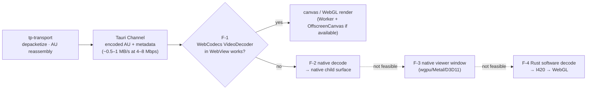

# ADR-002 — Media Transport, Control Channel and Video Path

| Field | Value |
|---|---|
| Status | **Accepted:** WebRTC as the transport, with a Rust-side stack on both peers; `tp-control` DataChannel; H.264 preference. **Proposed / open:** library choice (U-01), Controller render path (U-02), encoder implementation (U-04). |
| Date | 2026-10-28 |
| Phase | ARCH-00 (decided) → NET-03 (library) → VID-04 (render path, encoder) |
| Related | [ARCH-00](ARCH-00.md) D-06, D-07, D-08, D-10, FS-D, FS-E, FS-F, FS-I · [Threat model](../security/THREAT-MODEL.md) §6 |

## 1. Context

TP Remote must move three kinds of traffic between a Host and a Controller:

| Traffic | Direction | Requirements |
|---|---|---|
| Screen video | Host → Controller | Low latency (target p95 ≤ 200 ms on LAN), rate adaptation, keyframe on demand, loss tolerance |
| Input and control | Controller → Host (and status Host → Controller) | Reliable, ordered, low latency, small messages, strict validation |
| Signaling | Both | SDP and ICE exchange; must be **authenticated** to bind peer identity (D-10) |

Traffic starts on LAN and moves to the Internet in WAN-07, behind NATs, possibly through TURN relays. The brief sets WebRTC as the target, a DataChannel for input and control, and H.264 as the preferred codec, "subject to feasibility". The brief also warns: **a Rust WebRTC library does not provide screen capture, hardware codecs or input injection.** Those come from FS-A, FS-B, FS-C and FS-E.

## 2. Decision drivers

1. Standards-based NAT traversal (ICE/STUN/TURN) and DTLS-SRTP encryption.
2. Media features that real-time video needs: NACK, PLI/FIR, congestion control, pacing.
3. **One security model in Rust.** Peer identity binding and authorization must not depend on WebView JavaScript (TM-16).
4. Deterministic, network-free testing: loss and delay simulation, injectable clock.
5. Build simplicity and supply-chain hygiene on MSVC and Apple toolchains.
6. Room to move to an Internet relay (TURN) with no protocol redesign.

## 3. Considered options

### 3.1 Transport family

| Option | Summary | Verdict |
|---|---|---|
| **A. WebRTC, Rust-side stack on both peers** | Rust owns ICE, DTLS, SRTP and SCTP on Host and Controller. The Controller UI receives encoded frames over IPC | **Chosen** |
| B. WebRTC with the WebView's RTCPeerConnection on the Controller | The browser engine does decode and jitter buffering | Rejected. It splits security logic into JS, two WebRTC engines must interoperate with the Rust Host, and DTLS identity lives in the WebView (TM-16). Kept only as research input |
| C. Custom QUIC (`quinn`) | Simpler stack, own framing | Rejected as primary. Hand-made NAT traversal; QUIC congestion control is not tuned for real-time video. **Last-resort fallback** (FS-D) |
| D. Plain TCP/TLS streaming | Simple | Rejected. Head-of-line blocking hurts latency; no NAT traversal |

### 3.2 Rust WebRTC library (U-01, FS-D bake-off in NET-03)

The claims below come from project documentation found during ARCH-00 research. **All are UNVERIFIED.**

| Candidate | Observed state | Strengths | Concerns |
|---|---|---|---|
| **str0m** | 0.23.x on docs.rs; sans-IO; no internal threads; caller supplies time and I/O | Deterministic tests; small and auditable; pure Rust | Built-in bandwidth estimation not confirmed by search (UNKNOWN); smaller community |
| **webrtc-rs `webrtc` 0.20.x** on the sans-IO `rtc` core | Project blog (Jan 2026) claims feature parity and ~95% W3C API compliance; tokio and smol backends; 0.17.x is maintenance-only | W3C-like API; pure Rust; deterministic core | Release labelling inconsistent (RC vs stable across pages); congestion-control maturity UNKNOWN |
| **LiveKit `libwebrtc` / `webrtc-sys`** (Google libwebrtc) | Release notes cite libwebrtc m144; platform hardware encoders; passthrough pre-encoded publish path (July 2026) | Production-hardened congestion control, pacing and jitter buffer | Large C++ binary; prebuilt binary download (supply chain, TM-18); build complexity; tied to LiveKit's release cadence |

**Bake-off rules:**
- **Timebox:** decided within NET-03.
- **Criteria:** FS-D criteria 1–12 (ARCH-00 §10).
- **Must-haves:** criteria 1 (DataChannels), 2 (H.264 pre-encoded RTP), 3 (NACK and PLI surfaced), 5 (ICE host candidates and restart), 6 (fingerprint access) and 8 (permissive license).
- **Order of preference:** a pure-Rust sans-IO candidate that meets every must-have and passes FS-D3 (recovery under loss) is chosen. If none does, adopt libwebrtc bindings and record a supply-chain review. If libwebrtc also fails, revise this ADR (option C).

## 4. Decision

### 4.1 Transport

- **WebRTC** (ICE + DTLS 1.2/1.3 per library support + SRTP + SCTP DataChannels). The Rust-side stack sits behind the `Transport` contract in `tp-transport`.
- **Signaling** carries SDP and ICE only inside the PAKE-authenticated channel (D-10, U-03).
- After the DTLS handshake, `tp-core` independently compares the remote DTLS certificate fingerprint with the fingerprint in the authenticated SDP. On mismatch it raises `Fault{Authentication}`. This is defence in depth on top of the library's own check.
- **LAN MVP:** host candidates only; no STUN or TURN servers configured. **WAN-07:** STUN, plus TURN over UDP, TCP and TLS/443 with ephemeral credentials. TURN is untrusted (THREAT-MODEL TM-17).

### 4.2 Channels

| Name | Type | Contents |
|---|---|---|
| `tp-control` | DataChannel, reliable and ordered | `InputBatch`, layout, display selection, heartbeats, keyframe requests, timers, `Bye` (ARCH-00 §7.3) |
| *(evaluate in CTRL-05)* `tp-motion` | DataChannel, unordered, `maxRetransmits=0` | Pointer moves only, if head-of-line blocking under loss hurts pointer latency. Button events always carry a position, so splitting is safe. **Not in MVP unless CTRL-05 data justifies it** |
| Video | SRTP RTP stream | H.264 (RFC 6184) |

### 4.3 Codec and bitstream

- **H.264 Constrained Baseline**, `packetization-mode=1`, Annex B, no B-frames, SPS/PPS before every IDR, profile-level-id negotiated (e.g. `42e01f` for 720p30).
- **Initial LAN profile (PROPOSED, to be tuned in VID-04):** 1280×720 at 30 fps; target 4 Mbps (range 1–8 Mbps, driven by the bandwidth estimate); IDR on request (PLI/FIR, decoder `NeedKeyframe`) plus a periodic IDR every 10 s.
- **Encoder backends (U-04):** VideoToolbox (macOS) and Media Foundation hardware MFTs (Windows) first; OpenH264 software as fallback, under the Cisco-binary policy pending legal review.
- **Codec fallback:** VP8 if H.264 is blocked by licensing or compatibility. This requires a revision of this ADR.

### 4.4 Controller decode and render path (U-02, decided in VID-04)

- The path can be chosen **per platform**: WebView2 and WKWebView may end up on different paths.
- Raw RGBA frames over JSON IPC are rejected outright.

### 4.5 Latency and rate control responsibilities

| Concern | Owner |
|---|---|
| Frame pacing at the source (capture 30 fps cap, latest-wins slot) | `tp-capture` + `tp-core` |
| Encoder rate (`set_rate`) from the bandwidth estimate | `tp-core` media pipeline ← `TransportEvents::BitrateEstimate` |
| Keyframe on demand | `tp-core` ← `KeyframeRequested` / decoder `NeedKeyframe` |
| Retransmission (NACK/RTX), packetization and pacing | WebRTC library |
| Receiver: minimal jitter buffer, drop-until-IDR on overflow | `tp-transport` + desktop-ui `media/` |

## 5. Consequences

**Positive**
- One authenticated security model, in Rust, for both roles.
- Standards-based traversal is ready for WAN-07 without changing the protocol.
- A sans-IO choice allows deterministic simulation tests (`tp-transport::sim`) of loss, delay and reordering with no admin tools (R-13).

**Negative**
- If a pure-Rust stack is chosen, congestion control may be weaker than libwebrtc's (R-04).
- The render path in the WebView is uncertain (R-05), and the fallbacks cost platform-specific work.
- H.264 patent licensing is a legal dependency, not a technical one (R-08).

## 6. Validation plan

| Item | Tests | Phase |
|---|---|---|
| DataChannel reliability and ordering | T-INT-05, T-INT-06 | NET-03 |
| Fingerprint binding / MITM | T-SEC-12, T-UNI-20 | NET-03 |
| Loss recovery | T-NWK-03, T-NWK-04 | NET-03 (control), VID-04 (video) |
| Bandwidth adaptation | T-NWK-12 | VID-04 |
| Encoder/decoder compatibility | T-INT-03, T-INT-04 | VID-04 |
| Tauri channel throughput and latency | T-PRF-10 | VID-04 |
| End-to-end fps and latency targets | T-PRF-01, T-PRF-02 | VID-04, XPLAT-06 |

## 7. Revisit triggers

- No candidate passes the FS-D must-haves → option C (QUIC) or a different library.
- All FS-F render paths fail on a platform.
- Legal review blocks H.264 distribution → VP8.
- Latency p95 exceeds the target by more than 50% after tuning → profile and reconsider the stack.

## 8. References

RFC 8825, 8826, 8827, 8831, 8832, 5764, 6184, 8445, 8656, 7675. W3C WebCodecs. Project pages for webrtc-rs, str0m and LiveKit (see ARCH-00 §13).
