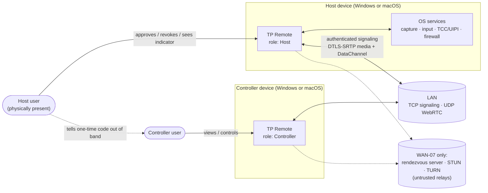
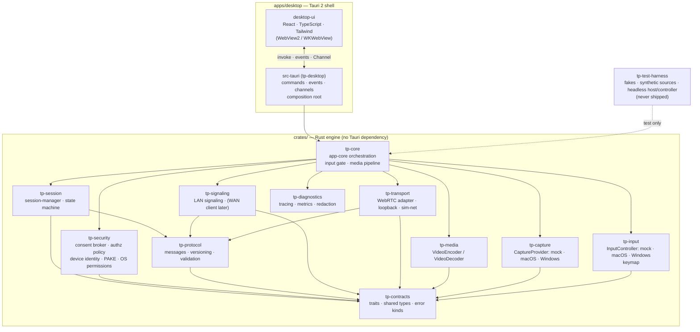
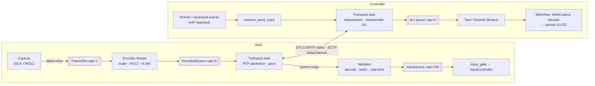
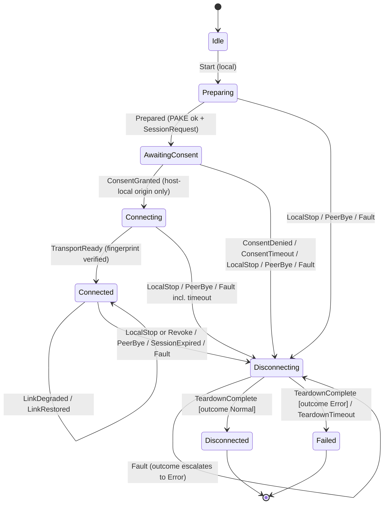
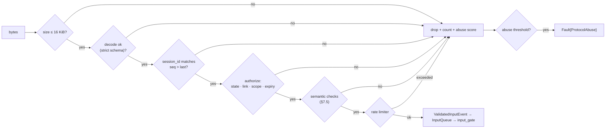
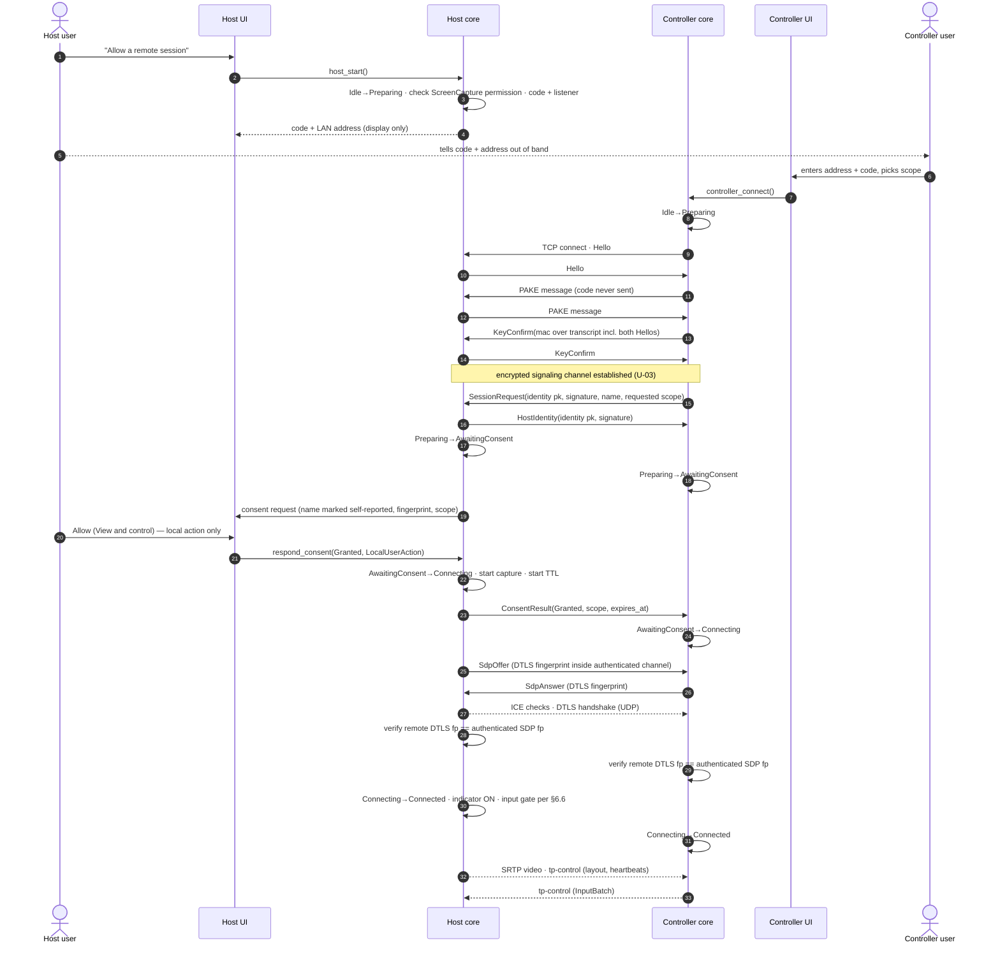
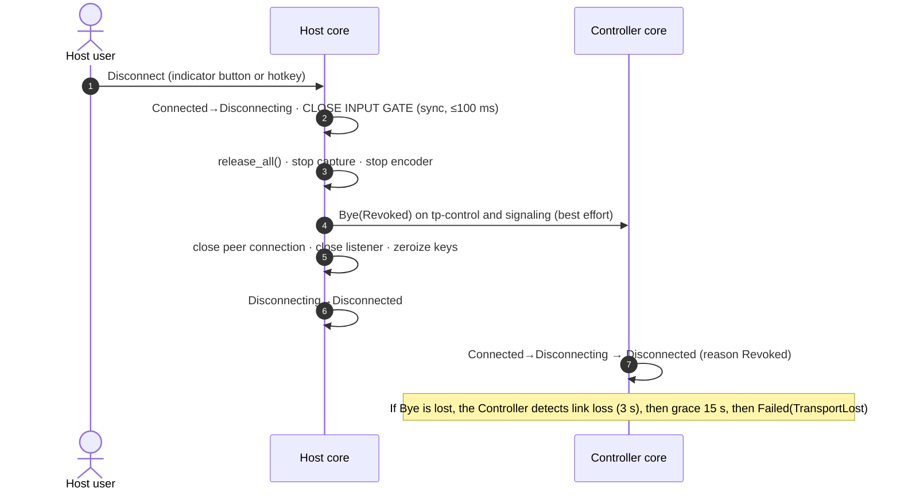
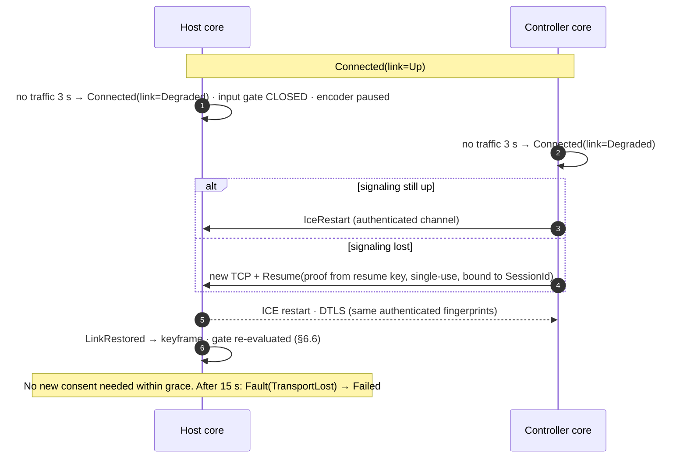

# ARCH-00 — TP Remote Architecture Baseline

| Field | Value |
|---|---|
| Phase | ARCH-00 (architecture, scope, security and QA baseline) |
| Status | Draft for review. Not approved until the user signs off. |
| Date | 2026-10-28 |
| Implementation in this phase | None. No application code exists yet. |
| Companion documents | [ADR-001 stack](ADR-001-stack.md) · [ADR-002 media transport](ADR-002-media-transport.md) · [Threat model](../security/THREAT-MODEL.md) · [Test strategy](../qa/TEST-STRATEGY.md) · [Test matrix](../qa/TEST-MATRIX.md) · [Prompt plan](../roadmap/PROMPT-PLAN.md) · [ARCH-00 report](../reports/ARCH-00-report.md) |

---

## 0. Conventions

**Status labels** (used in every TP Remote document):

| Label | Meaning |
|---|---|
| CONFIRMED | A baseline decision. It changes only through an ADR revision. |
| PROPOSED | A recommendation that still needs review or a spike result. |
| UNRESOLVED | An open decision, with an owning phase. |
| UNKNOWN | A fact that has not been established. Each UNKNOWN has a feasibility test. |
| UNVERIFIED | Documented by a vendor or community but not yet tested by us. |
| VERIFIED | Proven by an executed test with stored evidence. In ARCH-00 only environment facts are VERIFIED. |

**ID scheme:**
- `D-nn`: decision.
- `U-nn`: unresolved decision.
- `FS-x`: feasibility spike (A–J).
- `R-nn`: risk.
- `TM-nn`: threat (see the threat model).
- `SR-nn`: security requirement.
- `T-<CAT>-nn`: test (see the test matrix).
- Phase IDs: `ARCH-00` … `REL-09`.

**Roles.** Every TP Remote installation can act in either role, one role per session:
- **Host**: the machine being viewed and controlled. It shares its screen and receives input.
- **Controller**: the machine operating the Host remotely.

---

## 1. Product scope

### 1.1 Objective

TP Remote is a cross-platform, attended, consent-first remote desktop application. It must support four directions:

| Direction | Controller → Host |
|---|---|
| DIR-1 | macOS → Windows |
| DIR-2 | Windows → macOS |
| DIR-3 | Windows → Windows |
| DIR-4 | macOS → macOS |

The capabilities it must eventually deliver are:
- remote screen streaming;
- mouse and keyboard control;
- explicit local authorization;
- authenticated, encrypted sessions;
- connections over LAN first, and over the Internet later (WAN-07).

### 1.2 In scope for the POC/MVP (phases BOOT-01 to XPLAT-06)

- Attended sessions only, on a LAN, with one active session per device.
- Host-local consent with two scopes: **View only** and **View and control**.
- Streaming of one host display at a time. The Controller can switch between displays.
- Mouse (move, buttons, wheel) and physical-key keyboard input.
- A visible session indicator on the Host, immediate local disconnect, and session expiry.
- Diagnostics: metrics and redacted logs.

### 1.3 Explicitly out of scope (D-14)

The following are excluded:
- database, cloud deployment, mobile apps, billing, accounts or login;
- audio, file transfer, clipboard sync, printing, chat;
- session recording, or persisting frames by default;
- unattended access, auto-start, background services, privileged helpers, elevation;
- control of the secure desktop (UAC prompt, Ctrl+Alt+Del, lock screen, macOS login window);
- Internet connectivity before WAN-07. WAN-07 is post-POC and needs separate approval because the POC excludes cloud deployment.

### 1.4 IP and licensing constraints

- TP Remote is an independent implementation. Proprietary TeamViewer or UltraViewer code, binaries or protocols must not be copied or reverse engineered.
- RustDesk (github.com/rustdesk/rustdesk) is published under **AGPL-3.0**. Sources disagree on whether it is "-only" or "-or-later", so check the repository's LICENSE file. No RustDesk code may be copied or adapted unless the project deliberately adopts AGPL-compatible licensing. Whether engineers may even read RustDesk source while building equivalent modules is a legal-policy question (see U-15).
- Third-party crates and npm packages are admitted only after a license check (`cargo deny`, T-STA-06).

---

## 2. Decisions

### 2.1 Baseline decisions

| ID | Decision | Status | Source |
|---|---|---|---|
| D-01 | The desktop shell is **Tauri 2 + React + TypeScript + Tailwind CSS**. Tauri is *only* the shell: window, WebView, IPC and bundling. It is not a remote desktop engine. | CONFIRMED | ADR-001 |
| D-02 | The remote desktop engine is a **Rust Cargo workspace** under `crates/`. It does not depend on Tauri or the UI and can be run headless (`tp-test-harness`). | CONFIRMED | ADR-001 |
| D-03 | **Contracts first.** All cross-module traits and shared types live in `tp-contracts`. Platform code is confined to platform modules behind those contracts. | CONFIRMED | §4 |
| D-04 | **Capture APIs.** macOS uses ScreenCaptureKit. Windows uses Windows.Graphics.Capture (WGC) as primary, with DXGI Desktop Duplication as a fallback candidate (U-11). | CONFIRMED (primaries) | FS-A, FS-B |
| D-05 | **Input APIs.** macOS uses Quartz Event Services (`CGEventPost`). Windows uses Win32 `SendInput`. | CONFIRMED | FS-C |
| D-06 | **Transport is WebRTC** (ICE + DTLS + SRTP + SCTP DataChannels). Both peers use a **Rust-side WebRTC stack**; the WebView's own RTCPeerConnection is *not* used. The library choice is U-01. | CONFIRMED | ADR-002 |
| D-07 | Control and input messages go over one **reliable, ordered DataChannel**, `tp-control`. | CONFIRMED for MVP | ADR-002 |
| D-08 | The preferred video codec is **H.264 Constrained Baseline**, packetization-mode=1, Annex B, no B-frames. VP8 is a fallback candidate. Encoder implementation and licensing are U-04. | CONFIRMED preference | ADR-002, FS-E |
| D-09 | **Consent first.** Sessions are attended only, with one active session per device. The Host is authoritative for consent, scope and expiry; checks on the Controller side exist only for UX. | CONFIRMED | Threat model |
| D-10 | **Peer authentication.** The Host shows a one-time code, which feeds a **PAKE**. The PAKE-authenticated transcript binds the identity keys, the negotiated protocol version and the DTLS fingerprints. *The code alone never grants access*: the Host user must still approve. The PAKE primitive is U-03. | CONFIRMED design | Threat model §6 |
| D-11 | The **session state machine** has 8 states. Each session machine is used once. Every exit from an active state goes through `Disconnecting`. Invalid transitions are rejected. | CONFIRMED | §6 |
| D-12 | **Input semantics.** Pointer coordinates are fixed-point normalized values relative to a display the Host advertised, tagged with a layout epoch. Keys are physical key codes (USB HID usage). Raw network input can reach the OS only as a `ValidatedInputEvent` passing through the input gate. | CONFIRMED | §7, §8 |
| D-13 | The MVP streams **one host display at a time**, switchable. | CONFIRMED for MVP (revisit in UX-08) | §1.2 |
| D-14 | The POC exclusions in §1.3 apply. | CONFIRMED | Brief |
| D-15 | **Platform targets.** Windows 11 x64 is primary. Windows 10 22H2 is best-effort only; Microsoft ended support on 2025-10-14. macOS on Apple Silicon is primary. The minimum macOS version and Intel Mac support are U-08. | CONFIRMED (partly) | §12 |

### 2.2 Unresolved decisions

| ID | Question | Options | Recommendation | Owner phase | Blocks |
|---|---|---|---|---|---|
| U-01 | Which Rust WebRTC library? | str0m · webrtc-rs `webrtc` 0.20 (sans-IO `rtc` core) · LiveKit `libwebrtc`/`webrtc-sys` | Run a bake-off (FS-D). Prefer a pure-Rust sans-IO stack for deterministic tests; adopt libwebrtc if the pure-Rust stacks miss the FS-D criteria. | NET-03 | NET-03 exit |
| U-02 | How does the Controller decode and render video? | F-1 WebCodecs in the WebView · F-2 native surface · F-3 native viewer window · F-4 software decode to WebGL | F-1 first; fall back in order. | VID-04 | VID-04 exit |
| U-03 | Which PAKE primitive and crate, and how is the post-PAKE channel framed? | SPAKE2 (RFC 9382) · CPace (CFRG draft); Noise `NNpsk0` (`snow`) with PSK = PAKE key · custom AEAD framing | Use a vetted construction. A security review must approve it before NET-03 exits. | NET-03 | NET-03 exit |
| U-04 | Which H.264 encoder, and under which license? | VideoToolbox / Media Foundation hardware · OpenH264 (Cisco-distributed binary vs. source build) | Hardware first, OpenH264 as fallback. Legal review of patent coverage before any distribution. | VID-04 (+ legal) | REL-09 |
| U-05 | Which wire serialization? | Protobuf via `prost` (with pure-Rust `protox`, since protoc is absent) · `serde` + `postcard` | Protobuf for schema evolution and fuzzing tooling. Confirm the build path during BOOT-01. | BOOT-01 | BOOT-01 |
| U-06 | Where does the consent prompt render? | React dialog in the WebView · native OS dialog | Native dialog or hardened WebView dialog, decided after review of the threat to WebView integrity (TM-16). | NET-03 / UX-08 | NET-03 |
| U-07 | What is the default cross-OS modifier mapping? | Positional (Win↔Cmd) · shortcut-friendly (Ctrl↔Cmd) | Make it user-selectable; choose the default from UX testing. | CTRL-05 / XPLAT-06 | — |
| U-08 | What are the minimum OS versions? | macOS 13 / 14 / 15+; Windows 10 support; Intel Macs | macOS 14+ on Apple Silicon (affects ScreenCaptureKit and WebCodecs). Windows 11 primary. | Product owner, before CAP-02 | CAP-02 |
| U-09 | Which JS package manager? | npm (installed) · pnpm (needs corepack enable) | npm, since it requires no environment change. | BOOT-01 | BOOT-01 |
| U-10 | How is the macOS build distributed, and with which entitlements? | Developer ID outside the Mac App Store · MAS; request `persistent-content-capture` | Developer ID with hardened runtime; evaluate the entitlement. | REL-09 (affects CAP-02 UX) | REL-09 |
| U-11 | Is a DXGI fallback needed on Windows? | WGC only · WGC + DXGI | Decide from the CAP-02 measurements. | CAP-02 | — |
| U-12 | How does the Controller find a Host on the LAN? | Manual address + code · opt-in mDNS | Manual entry for the MVP (no broadcast; see TM-21). | NET-03 | — |
| U-13 | How are Rust↔TS IPC types shared? | Hand-written TS types plus contract tests · code generation | Hand-written plus tests in BOOT-01; reassess later. | BOOT-01 | — |
| U-14 | Who hosts and owns WAN infrastructure (rendezvous server, TURN)? | Self-hosted · managed | Requires explicit approval; out of the POC. | Before WAN-07 | WAN-07 |
| U-15 | What is TP Remote's own license and commercial model? | Proprietary · OSS (which license) | Needed to finalize the dependency license policy (`deny.toml`). | Before BOOT-01 adds dependencies | BOOT-01 policy |
| U-16 | Where is the device private key stored? | macOS Keychain; Windows DPAPI vs. Credential Manager | OS keystore only, never plaintext. | NET-03 | — |

> **Status update (BOOT-01, 2026-10-28):** the user decided U-05, U-09, U-13 and U-15.
> - **U-05:** versioned JSON with Serde, not Protobuf (ADR-002 amendment A1).
> - **U-09:** npm (ADR-001 amendment A1).
> - **U-13:** ts-rs generated bindings, not hand-written types (ADR-001 amendment A1).
> - **U-15:** private internal development, all rights reserved (ADR-001 amendment A1).
>
> The IPC command listed as `app_info` in §3.5 is implemented as `get_app_info`. The recommendations above for U-05 and U-13 are kept for history only.

---

## 3. System architecture

### 3.1 Context



### 3.2 Logical architecture



### 3.3 Module catalog and boundaries

| Conceptual module | Crate / path | Responsibility | May depend on (internal) | Must NOT depend on | `unsafe` / FFI |
|---|---|---|---|---|---|
| desktop-ui | `apps/desktop/src` | Screens, consent dialog, session indicator, remote viewport (decode/render), input capture and normalization, permission guidance | `core-api/` wrapper only (calls Tauri) | Direct `@tauri-apps/api` calls outside `core-api/`; any secret material | n/a (TS) |
| desktop shell | `apps/desktop/src-tauri` (`tp-desktop`) | Composition root: builds `tp-core` with platform implementations. Thin command handlers that validate and delegate. Event and channel bridging. Tauri ACL/CSP config | `tp-core`, `tp-contracts`, `tp-diagnostics` | Platform crates' internals; protocol parsing | None (except Tauri itself) |
| app-core | `crates/tp-core` | Orchestrates sessions, pipelines and the **input gate**, which is the only holder of an `InputController`. Bridges events to the shell | All engine crates | `tauri` | No (forbid) |
| session-manager | `crates/tp-session` | The `SessionManager` actor, state machine, timers and teardown ordering | `tp-contracts`, `tp-protocol` | Platform crates, transport internals | No (forbid) |
| security / consent | `crates/tp-security` | `PermissionManager` (OS permissions), `AuthorizationPolicy`, consent broker, `DeviceIdentity`, PAKE handshake and key schedule, zeroization | `tp-contracts`, `tp-protocol` (handshake messages) | UI, transport | Only in OS-keystore and OS-permission bindings (cfg-gated) |
| protocol | `crates/tp-protocol` | Wire schema, envelope, version negotiation, decoding limits, **validation** (the only producer of `ValidatedInputEvent`), rate limiters | `tp-contracts` | Everything else | No (forbid) |
| platform-capture | `crates/tp-capture` | `CaptureProvider` implementations: `mock`, `synthetic`, `macos` (ScreenCaptureKit), `windows` (WGC, plus DXGI if U-11 says so) | `tp-contracts` | Network, protocol, async runtime | Yes, confined to `macos/`, `windows/` |
| platform-input | `crates/tp-input` | `InputController` implementations: `mock` (recording), `macos` (CGEvent), `windows` (SendInput); keymap tables | `tp-contracts` | Network, protocol | Yes, confined to `macos/`, `windows/` |
| media-codec | `crates/tp-media` | `VideoEncoder`/`VideoDecoder`: `passthrough` (test), `openh264`, `videotoolbox`, `mediafoundation`; colour conversion helpers | `tp-contracts` | Network | Yes, in platform backends |
| media-transport | `crates/tp-transport` | `Transport` implementations: WebRTC adapter (U-01), in-memory `loopback`, `sim` network with loss and delay | `tp-contracts`, `tp-protocol` | Capture, input, UI | Only if the chosen library needs FFI |
| signaling | `crates/tp-signaling` | LAN listener and connector, framing, handshake driver. WAN rendezvous client later | `tp-contracts`, `tp-protocol` | Capture, input, media | No (forbid) |
| diagnostics | `crates/tp-diagnostics` | `tracing` setup, **redaction layer**, metrics registry, resource gauges, latency probes | `tp-contracts` | Everything else | No (forbid) |
| test-harness | `crates/tp-test-harness` | Fakes, fixtures, synthetic frame source, fake clock, headless host and controller binaries, fuzz corpora | Any (dev-only) | Must never be a dependency of release artifacts | As needed (tests) |

**Dependency rules.** These are enforced by T-STA-08, a script over `cargo metadata`.
1. `tp-contracts` has no internal dependencies.
2. Platform crates (`tp-capture`, `tp-input`, `tp-media`) depend only on `tp-contracts` and OS bindings. They are **synchronous and runtime-agnostic**: no tokio.
3. Only `tp-core` wires implementations together. Only `apps/desktop/src-tauri` depends on `tauri`.
4. `tp-test-harness` and any `test-harness` cargo feature are rejected in release builds, which is checked by T-STA-10. The harness is the only place an auto-consent switch exists.
5. `#![forbid(unsafe_code)]` applies in `tp-contracts`, `tp-protocol`, `tp-session`, `tp-signaling`, `tp-diagnostics` and `tp-core`.

### 3.4 Proposed directory structure

```text
tp-remote/
├─ Cargo.toml                 # [workspace] members, shared lints, profiles   (BOOT-01)
├─ rust-toolchain.toml        # stable channel pin, chosen in BOOT-01          (BOOT-01)
├─ deny.toml                  # cargo-deny: licenses, advisories, sources     (BOOT-01)
├─ package.json               # npm workspaces root (U-09)                    (BOOT-01)
├─ scripts/
│  ├─ check.ps1 / check.sh    # runs all static + unit gates locally
│  └─ boundaries.(ps1|sh)     # T-STA-08 dependency-rule check
├─ apps/
│  └─ desktop/
│     ├─ package.json
│     ├─ src/                 # desktop-ui
│     │  ├─ app/              # screens: Home, Host, Connect, Session, Settings, Diagnostics
│     │  ├─ components/       # ConsentDialog, SessionIndicator, RemoteViewport, Toolbar, PermissionGuide
│     │  ├─ core-api/         # ONLY module that imports @tauri-apps/api; typed commands/events
│     │  ├─ media/            # WebCodecs decoder, canvas renderer, frame timing (VID-04)
│     │  ├─ input/            # pointer/keyboard capture → normalized events (CTRL-05)
│     │  ├─ i18n/             # en, vi (UX-08)
│     │  └─ test/             # Vitest setup, IPC mocks
│     ├─ e2e/                 # Playwright specs (mocked IPC; WebView2 CDP where feasible)
│     └─ src-tauri/
│        ├─ Cargo.toml        # crate tp-desktop
│        ├─ tauri.conf.json   # CSP, bundle config
│        ├─ capabilities/     # Tauri ACL: only TP Remote commands, main window only
│        └─ src/{main.rs, lib.rs, commands/, events.rs}
├─ crates/
│  ├─ tp-contracts/  ├─ tp-protocol/   ├─ tp-session/   ├─ tp-security/
│  ├─ tp-capture/    ├─ tp-input/      ├─ tp-media/     ├─ tp-transport/
│  ├─ tp-signaling/  ├─ tp-diagnostics/├─ tp-core/      └─ tp-test-harness/
├─ fuzz/                      # cargo-fuzz targets for tp-protocol (NET-03; nightly toolchain, approval needed)
└─ docs/
   ├─ architecture/  ├─ security/  ├─ qa/ (evidence/, results/)  ├─ roadmap/  └─ reports/
```

Each crate uses the layout `src/lib.rs`, `src/<platform>/…` (cfg-gated), `tests/` for integration tests, and a `README.md` stating its boundary rules.

### 3.5 Tauri boundary

- **Shell only.** Tauri owns windows, the WebView, the IPC transport, bundling, and later the updater. All remote-desktop logic lives in `crates/`.
- **IPC surface (initial).** Every command validates its arguments in Rust.

  Commands:
  - `app_info`
  - `permissions_status`, `permissions_request`, `permissions_open_settings`
  - `host_start`, `host_regenerate_code`
  - `consent_respond`
  - `controller_connect`
  - `session_disconnect`, `session_select_display`, `session_send_input`, `session_send_keys`
  - `diagnostics_snapshot`

  Events:
  - `session://state`
  - `session://consent-request`
  - `session://timer`
  - `session://stats`
  - `permissions://changed`

  Channel: one `video` channel per Controller session, carrying encoded access units plus metadata (FS-F).
- **Security configuration.**
  - Strict CSP: `script-src 'self'`, no remote origins.
  - No remote content loaded; DevTools disabled in release.
  - Capabilities grant only TP Remote commands, to the main window only. No `shell`, `fs` or `http` plugins.
  - All peer-supplied strings are sanitized in Rust and rendered as text only; `dangerouslySetInnerHTML` is forbidden.
  - Evaluate Tauri's isolation pattern and prototype freezing (TM-16).
- **No localhost servers.** Frames and control never go through local HTTP or WebSocket ports, because other local processes could reach them (TM-15).

---

## 4. Contracts (defined before implementations)

The signatures below are **illustrative Rust**. BOOT-01 turns them into compilable code in `tp-contracts`. After BOOT-01, any contract change must be recorded as a "Contract change" entry in the phase report, with rationale and the modules it affects.

### 4.1 Shared types

```rust
pub struct SessionId([u8; 16]);          // CSPRNG, never reused
pub struct DeviceId(String);             // derived from identity public key (hash, base32)
pub enum  Role  { Host, Controller }
pub enum  Scope { ViewOnly, ViewAndControl }
pub struct MonoTime(u64);                // monotonic µs; never wall-clock for ordering

pub struct DisplayId(u32);               // opaque, stable within a layout epoch
pub struct DisplayInfo {
    pub id: DisplayId,
    pub name: String,                    // sanitized
    pub bounds_os: RectI32,              // OS space: Windows = physical px of virtual desktop;
                                         //           macOS  = global points (Quartz, y down)
    pub size_px: SizeU32,                // native pixel size
    pub scale: f32,                      // px per OS unit (Win PMv2 = 1.0, Retina = 2.0)
    pub is_primary: bool,
}
pub struct DisplayLayout { pub epoch: u32, pub displays: Vec<DisplayInfo> }

pub enum PixelFormat { Bgra8, Nv12 }
pub enum FrameData { Cpu(CpuFrame), Gpu(GpuFrame) }   // GpuFrame wraps IOSurface / ID3D11Texture2D
pub struct CapturedFrame {
    pub display: DisplayId, pub seq: u64, pub captured_at: MonoTime,
    pub size_px: SizeU32, pub format: PixelFormat, pub data: FrameData,
}
pub struct EncodedFrame {
    pub seq: u64, pub captured_at: MonoTime, pub keyframe: bool,
    pub codec: Codec, pub bitstream: bytes::Bytes,   // H.264 Annex B; SPS/PPS before every IDR
}

pub enum ErrorKind {
    PermissionDenied, NotSupported, InvalidInput, Protocol, Authentication,
    Rejected, Timeout, Transport, Capture, Codec, Input, ResourceExhausted,
    Cancelled, Internal,
}
```

### 4.2 CaptureProvider

```rust
pub trait CaptureProvider: Send + Sync {
    fn capabilities(&self) -> CaptureCapabilities;            // formats, max fps, gpu frames, cursor
    fn displays(&self) -> Result<DisplayLayout, CaptureError>;
    /// Starts capturing ONE display. Frames are pushed to `sink` from a provider-owned thread.
    /// tp-core calls this only after consent (state Connecting/Connected) — see §6.6 media gate.
    fn start(&self, cfg: CaptureConfig, sink: Arc<dyn FrameSink>)
        -> Result<Box<dyn CaptureStream>, CaptureError>;
}
pub trait CaptureStream: Send {
    fn reconfigure(&mut self, cfg: CaptureConfig) -> Result<(), CaptureError>;
    /// Blocks up to cfg.stop_timeout; idempotent; Drop calls it as a last resort.
    fn stop(self: Box<Self>) -> Result<CaptureStats, CaptureError>;
}
pub trait FrameSink: Send + Sync {
    fn on_frame(&self, frame: CapturedFrame);   // MUST NOT block or panic (latest-wins slot)
    fn on_event(&self, ev: CaptureEvent);       // LayoutChanged, PermissionRevoked, Stopped, Error
}
```

### 4.3 InputController

```rust
pub trait InputController: Send {
    fn capabilities(&self) -> InputCapabilities;               // absolute pointer, key set, wheel modes
    /// `InjectableEvent` is in OS space (already mapped). Only tp-core::input_gate calls this.
    fn inject(&mut self, ev: &InjectableEvent) -> Result<(), InputError>;
    /// Releases every key/button this controller pressed. Safe to call repeatedly.
    fn release_all(&mut self) -> Result<(), InputError>;
}
```

Raw network input cannot reach `inject` because of three ownership and type rules:
- `tp-protocol::validate` is the only producer of `ValidatedInputEvent`. Its fields are private and it has no public constructor.
- `tp-core::input_gate` is the only owner of the `Box<dyn InputController>`. It accepts nothing but `ValidatedInputEvent`, checks the gate condition (§6.6), maps the event to an `InjectableEvent` (§8), then injects it.
- T-STA-08 asserts that `inject(` has call sites only in `input_gate`.

### 4.4 SessionManager

```rust
pub trait SessionManager: Send + Sync {
    async fn host_start(&self, opts: HostOptions) -> Result<HostOffer, SessionError>;
        // HostOffer { session_id, one_time_code: SecretString (UI display only), listen_addrs, expires_at }
    async fn controller_connect(&self, target: PeerAddress, code: SecretString, scope: Scope)
        -> Result<SessionId, SessionError>;
    /// Host only. `origin` can only be minted by the shell's consent command handler.
    async fn respond_consent(&self, id: SessionId, d: ConsentDecision, origin: LocalUserAction)
        -> Result<(), SessionError>;
    async fn disconnect(&self, id: SessionId, why: LocalStopKind) -> Result<(), SessionError>; // idempotent
    fn snapshot(&self, id: SessionId) -> Option<SessionSnapshot>;
    fn subscribe(&self) -> EventStream<SessionEvent>;  // state changes, consent requests, timers, stats
}
```

### 4.5 Transport and signaling link

```rust
pub trait SignalingLink: Send {              // already authenticated + encrypted (post-PAKE)
    async fn send(&mut self, m: SignalingMessage) -> Result<(), SignalingError>;
    async fn recv(&mut self) -> Result<SignalingMessage, SignalingError>;
}
pub trait Transport: Send + Sync {
    async fn establish(&self, p: TransportParams, link: &mut dyn SignalingLink,
                       cancel: CancellationToken) -> Result<Box<dyn TransportSession>, TransportError>;
}
pub struct TransportParams { pub role: Role, pub ice_servers: Vec<IceServer>,
                             pub local_cert: DtlsCertificate, pub video: Option<VideoParams> }
pub trait TransportSession: Send {
    fn send_video(&self, f: EncodedFrame) -> Result<SendOutcome, TransportError>; // non-blocking; Backpressure
    fn video_rx(&mut self) -> FrameReceiver;                                     // Controller
    fn send_control(&self, msg: bytes::Bytes) -> Result<(), TransportError>;
    fn control_rx(&mut self) -> ControlReceiver;
    fn events(&mut self) -> TransportEvents;  // LinkDegraded, LinkRestored, KeyframeRequested,
                                              // BitrateEstimate(bps), Closed(reason)
    fn remote_dtls_fingerprint(&self) -> Option<Fingerprint>;   // checked by tp-core vs authenticated SDP
    fn stats(&self) -> TransportStats;
    async fn close(self: Box<Self>, why: CloseReason) -> Result<(), TransportError>;
}
```

### 4.6 VideoEncoder / VideoDecoder

```rust
pub trait VideoEncoder: Send {
    fn info(&self) -> EncoderInfo;                                  // name, hardware?, input formats
    fn configure(&mut self, cfg: &EncoderConfig) -> Result<(), CodecError>; // profile, size, fps, bitrate
    fn encode(&mut self, f: &CapturedFrame, o: EncodeOptions)       // o.force_keyframe
        -> Result<Vec<EncodedFrame>, CodecError>;                   // 0..n outputs (async HW MFTs)
    fn set_rate(&mut self, bitrate_bps: u32, max_fps: u32) -> Result<(), CodecError>;
    fn flush(&mut self) -> Result<Vec<EncodedFrame>, CodecError>;
}
pub trait VideoDecoder: Send {                                      // native fallback + test oracle
    fn configure(&mut self, cfg: &DecoderConfig) -> Result<(), CodecError>;
    fn decode(&mut self, f: &EncodedFrame) -> Result<Option<DecodedFrame>, CodecError>; // NeedKeyframe → PLI
    fn reset(&mut self);
}
```

### 4.7 PermissionManager, AuthorizationPolicy, DeviceIdentity

```rust
pub enum OsPermission { ScreenCapture, InputInjection }  // mac: Screen Recording, Accessibility(PostEvent)
pub enum PermissionStatus { Granted, Denied, NotDetermined, Restricted, RequiresRelaunch, Unknown }
pub trait PermissionManager: Send + Sync {
    fn status(&self, p: OsPermission) -> PermissionStatus;    // re-queried each time; never cached for a session
    fn request(&self, p: OsPermission) -> PermissionStatus;   // OS prompt only; NEVER automate/bypass
    fn open_system_settings(&self, p: OsPermission) -> Result<(), PermissionError>;
}
pub enum Action { StartCapture, StreamVideo, InjectInput, SelectDisplay, ExtendSession }
pub trait AuthorizationPolicy: Send + Sync {                 // pure; host-authoritative
    fn authorize(&self, s: &SessionAuthz, a: Action) -> Result<(), Denied>;
}
pub trait DeviceIdentity: Send + Sync {                      // key never leaves the keystore abstraction
    fn device_id(&self) -> DeviceId;
    fn public_key(&self) -> IdentityPublicKey;               // Ed25519 proposed (NET-03 confirms)
    fn sign(&self, ctx: SignContext, msg: &[u8]) -> Result<Signature, IdentityError>; // domain-separated
    fn display_fingerprint(&self) -> String;                 // human-comparable groups
}
```

---

## 5. Runtime model

### 5.1 Execution contexts

| Context | Kind | Owns | Talks to |
|---|---|---|---|
| UI thread (WebView) | JS event loop | React state (no secrets) | Shell via invoke, events, channel |
| Tauri main / IPC | Tauri runtime | Command handlers (thin) | `tp-core` handle (async) |
| Core runtime | tokio multi-thread | `SessionManager` **actor**, which processes one mailbox serially so there are no locks around session state; signaling tasks | All engine services via channels |
| Transport driver | one tokio task per session | UDP sockets, the sans-IO WebRTC state, timers (single owner) | Encoder output queue, control channels |
| Capture callback | OS-owned: SCK dispatch queue or WGC free-threaded pool | Nothing long-lived. It pushes into `FrameSlot` | `FrameSlot` |
| Encoder worker | dedicated OS thread | Encoder instance, GPU conversion context | `FrameSlot` → `EncodedQueue` |
| Input worker (Host) | dedicated OS thread | `InputController` (via `input_gate`) | `InputQueue` from the validator |
| Diagnostics | tokio task | Metrics aggregation (1 s), log sinks | Read-only snapshots |

Rules:
- No blocking calls on tokio worker threads; blocking work uses dedicated threads or `spawn_blocking`.
- FFI callbacks wrap their bodies in `catch_unwind`, because unwinding across FFI is undefined behaviour.
- A panic in any pipeline thread is converted to `Fault{Internal}`.

### 5.2 Media data path and buffering



| Queue | Capacity | Overflow policy | Metric |
|---|---|---|---|
| `FrameSlot` (capture → encoder) | 1 | Replace the older frame (latest-wins) | `capture_frames_replaced` |
| `EncodedQueue` (encoder → transport) | 4 access units (≈133 ms at 30 fps) | Drop the newest *non-key* frame, then force the next frame to be a keyframe | `encoded_dropped`, `forced_keyframes` |
| Transport send/pacer | Inside the library | Bitrate estimate (BWE) feeds `VideoEncoder::set_rate` | `bwe_bps`, `rtt_ms`, `loss_pct` |
| Controller AU queue → UI | 4 | Drop until the next keyframe and send a `KeyframeRequest` | `rx_dropped_until_idr` |
| `InputQueue` (validator → input worker) | 256 events | Pointer moves are coalesced. Key and button events are **never dropped**; if they would overflow, raise `Fault{ProtocolAbuse}` | `input_coalesced`, `input_overflow` |
| UI → core input | Batched per animation frame | Moves coalesced to the latest position | `ui_input_batches` |

Nothing in the pipeline is unbounded. Capture never waits on the encoder, and the encoder never waits on the network.

### 5.3 Ownership and lifecycle

- `SessionManager` (the actor) owns a `SessionContext` per session. `SessionContext` holds:
  - `Option<CaptureStream>`, `Option<EncoderWorker>`, `Option<Box<dyn TransportSession>>`, `Option<InputWorker>`;
  - `SignalingConn`, a root `CancellationToken`, timers, `SessionAuthz`, and key material in `Zeroizing<…>`.
- Every resource handle supports an explicit `shutdown()` (async where needed) **and** a `Drop` that cleans up as a last resort and logs a `leak_on_drop` warning.
- Each pipeline stage holds a **child** cancellation token, so cancelling the session cancels every stage.
- Platform objects (SCStream, GraphicsCaptureSession, MF transforms, CGEventSource) are created and destroyed on the thread their API requires, and that thread is documented in each implementation.

### 5.4 Error handling

- Each crate has a `thiserror` enum that maps to `ErrorKind` (§4.1) with `recoverable: bool`. `anyhow` is used only in binaries and tests.
- OS error codes (HRESULT, OSStatus, NSError domain/code) are preserved for diagnostics and are **never** passed straight to UI text.
- Errors that are user-visible map to stable, localized messages without secrets, IPs or paths.
- Recoverable errors are retried by policy only: capture reconfiguration on a layout change, and ICE restart within the grace period. Every other error becomes `Fault{kind}` → `Disconnecting` → `Failed`.
- Security-relevant rejections (invalid transition, authorization denial, validation failure) are counted, logged at `warn` with redaction, and surfaced in `diagnostics_snapshot`.

### 5.5 Cancellation and teardown order

On entering `Disconnecting`, the actor runs the following steps. Each step has a 2 s timeout; the whole teardown is under a 5 s watchdog.

1. **Close the input gate.** This is synchronous and happens inside the transition handler, before any `await`.
2. Stop the input worker, then call `release_all()` to release every key and button that is still pressed (TM-25).
3. Stop capture (`SCStream.stopCapture` / close the `GraphicsCaptureSession`).
4. Stop and flush the encoder (output is discarded) and free GPU resources.
5. Send `Bye{reason}` on the control channel (best effort), then close the DataChannels and the peer connection.
6. Send `Bye` on signaling and close it; close the LAN listener if this session opened it.
7. Zeroize the session keys, the code and the resume token.
8. Emit the terminal state (`Disconnected` or `Failed`) and the final stats.

If the watchdog fires, the session goes to `Failed{TeardownTimeout}`, the leaked resource gauges are recorded, and the user is told.

### 5.6 Resource-cleanup verification

`tp-diagnostics` exposes gauges:
- `active_sessions`, `capture_streams`, `encoders`, `transports`, `udp_sockets`, `input_workers`, `listeners`;
- process `threads` and `handles` (Windows) or `fds` (macOS).

Tests assert that every gauge returns to its pre-session baseline after each session (T-INT-08, T-PRF-08).

### 5.7 Latency budget (ESTIMATE, UNVERIFIED)

| Stage | Expected range at 720p30 (LAN) |
|---|---|
| Capture wait (frame interval) + delivery | 0–33 ms + ~2–5 ms |
| Scale / colour conversion (GPU) | 1–5 ms |
| Encode | HW 3–15 ms · SW 10–30 ms |
| Packetize + pacing | 1–10 ms |
| LAN network | 1–5 ms |
| Reassembly + IPC to WebView | 1–5 ms (FS-F3) |
| Decode | 2–10 ms |
| Render + display vsync | 0–17 ms (60 Hz) |
| **Total** | **≈ 40–135 ms** (estimate). The p95 target of ≤ 200 ms is plausible but **unproven** (R-10). |

---

## 6. Session state machine

### 6.1 States

| State | Meaning | Host activity | Controller activity | Input gate | Media allowed |
|---|---|---|---|---|---|
| Idle | A fresh session object | None | None | Closed | No |
| Preparing | Setup and authentication | Generates the code, opens the listener, checks OS permissions, waits for an authenticated request (PAKE + `SessionRequest`) | Connects to the Host, runs Hello and PAKE, sends `SessionRequest` | Closed | No |
| AwaitingConsent | Waiting for the Host user's decision | Shows the consent prompt and starts the consent timer | Waits for an authenticated `ConsentResult` | Closed | No |
| Connecting | Consent granted; transport being set up | Starts capture (frames are discarded until Connected); SDP, ICE and DTLS; fingerprint check | SDP, ICE and DTLS; fingerprint check | Closed | Capture may start; nothing is sent |
| Connected | Session active. Sub-flag `link ∈ {Up, Degraded}` | Streams video; injects validated input if scope allows; indicator visible | Renders video, sends input | Open only if the §6.6 conditions hold | Yes (while link is Up) |
| Disconnecting | Ordered teardown (§5.5) | Teardown | Teardown | Closed | No |
| Disconnected | Terminal: normal end | — | — | Closed | No |
| Failed | Terminal: ended because of an error | — | — | Closed | No |

A session machine is used **once**. After `Disconnected` or `Failed`, a new attempt creates a new `SessionId` and a new machine in `Idle`, with fresh keys and a fresh consent.

### 6.2 Diagram



### 6.3 Transition table

Any `(state, event)` pair that is not listed here is **invalid**.

| # | From | Event | Origin | Guard | To | Actions |
|---|---|---|---|---|---|---|
| 1 | Idle | `Start{role}` | local UI | OS screen-capture permission Granted (Host) | Preparing | Host: generate code and open listener. Controller: connect |
| 2 | Preparing | `Prepared` | internal | PAKE key confirmation ok; `SessionRequest` signature valid; no other active session | AwaitingConsent | Host: raise consent request (UI). Controller: start consent wait timer |
| 3 | Preparing | `LocalStop` / `PeerBye` | local / authenticated remote | — | Disconnecting (Normal) | Teardown |
| 4 | Preparing | `Fault` | internal | e.g. `Authentication`, `Timeout`, `Busy` | Disconnecting (Error) | Teardown |
| 5 | AwaitingConsent | `ConsentGranted{scope}` | **Host: `LocalUserAction` only.** Controller: authenticated `ConsentResult` | scope ≤ requested scope | Connecting | Host: start capture and the session TTL timer |
| 6 | AwaitingConsent | `ConsentDenied` | same origins as #5 | — | Disconnecting (Normal) | Send `ConsentResult{Denied}` |
| 7 | AwaitingConsent | `ConsentTimeout` | Host timer (60 s) | — | Disconnecting (Normal) | Send `ConsentResult{TimedOut}` |
| 8 | AwaitingConsent | `LocalStop` / `PeerBye` | — | — | Disconnecting (Normal) | — |
| 9 | AwaitingConsent | `Fault` | internal (the Controller's own wait times out at 70 s) | — | Disconnecting (Error) | — |
| 10 | Connecting | `TransportReady` | internal | DTLS remote fingerprint equals the fingerprint in the authenticated SDP; `tp-control` open | Connected(link=Up) | Show indicator; open input gate if §6.6 holds |
| 11 | Connecting | `LocalStop` / `PeerBye` | — | — | Disconnecting (Normal) | — |
| 12 | Connecting | `Fault` | internal (incl. 20 s timeout, fingerprint mismatch) | — | Disconnecting (Error) | — |
| 13 | Connected | `LinkDegraded` | internal (3 s without traffic) | link=Up | Connected(link=Degraded) | **Close input gate**, pause encoder, start 15 s grace, attempt resume (§9.3) |
| 14 | Connected | `LinkRestored` | internal | link=Degraded; resume authenticated | Connected(link=Up) | Request keyframe; reopen gate if §6.6 holds |
| 15 | Connected | `LocalStop` (Disconnect/Revoke) | local UI / hotkey | — | Disconnecting (Normal) | — |
| 16 | Connected | `PeerBye{reason}` | authenticated remote | — | Disconnecting (Normal or Error, depending on reason) | — |
| 17 | Connected | `SessionExpired` | Host TTL timer | — | Disconnecting (Normal) | Send `Bye{Expired}` |
| 18 | Connected | `Fault` | internal (grace expired, protocol abuse, permission revoked, …) | — | Disconnecting (Error) | — |
| 19 | Disconnecting | `Fault` | internal | — | Disconnecting | Escalate outcome to Error and record the error |
| 20 | Disconnecting | `TeardownComplete` | internal | outcome = Normal | Disconnected | Emit final stats |
| 21 | Disconnecting | `TeardownComplete` / `TeardownTimeout` | internal / watchdog 5 s | outcome = Error, or watchdog fired | Failed | Emit error + leak gauges |

**Outcome classes:**
- **Normal → `Disconnected`:** user disconnect, revoke, denial, consent timeout, expiry, peer `Bye` with a normal reason, cancel.
- **Error → `Failed`:** authentication failure, timeouts in `Preparing`/`Connecting`, transport lost beyond grace, protocol violation or abuse, permission revoked mid-session, internal error, teardown timeout.

### 6.4 Rejection rules

- `SessionManager::apply(event)` returns `Result<State, TransitionError>`. A rejected event **does not mutate** state. It is logged as a security event and increments `transition_rejected{state,event}`.
- **Role and origin guards:**
  - On the Host, `ConsentGranted` or `ConsentDenied` with a remote origin is rejected and raises `Fault{Protocol}` (an attempt by the Controller to self-approve).
  - On the Controller, a local-origin consent event is rejected.
- `LocalStop` while in `Disconnecting`, `Disconnected` or `Failed` is rejected by the machine, but the `disconnect()` API treats it as success (idempotent).
- A second inbound session request while the device is not `Idle` gets `Busy` at the signaling layer. No consent prompt is shown (TM-19, T-INT-12).

### 6.5 Timers (initial values, PROPOSED; configurable and tuned by measurement)

| Timer | Value | Authority |
|---|---|---|
| One-time code TTL / max failed attempts | 10 min / 3 attempts, then the code is invalidated | Host |
| Handshake (Hello → key confirmation) | 10 s | Both |
| Consent decision | 60 s, then auto-deny (Controller waits 70 s) | Host |
| Connecting (ICE + DTLS + channel open) | 20 s | Both |
| Heartbeat / link degraded / reconnect grace | 1 s / 3 s / 15 s | Both; the Host enforces gating |
| Session TTL | 60 min, warning at T−5 min. Host can extend locally by +30 min | Host only |
| Teardown step / total watchdog | 2 s / 5 s | Local |
| Revoke service levels | Input gate closed ≤ 100 ms, capture stopped ≤ 1 s, Controller notified ≤ 2 s (if link is up) | Host (T-SEC-06) |

### 6.6 Gates (invariants checked by T-UNI-04 property tests)

- **Media gate (Host):** capture may start only after `ConsentGranted`, in states `Connecting` or `Connected`. Video may be sent only in `Connected` with `link=Up`.
- **Input gate (Host):** open **iff** all of the following hold:
  - `state = Connected`
  - `link = Up`
  - `scope = ViewAndControl`
  - `now < expires_at`
  - `PermissionManager.status(InputInjection) = Granted`
  - the event is a `ValidatedInputEvent` for this `SessionId` and the current layout epoch.

  Any transition out of `Connected`, or into `Degraded`, closes the gate synchronously.

---

## 7. Protocol

### 7.1 Channels

| Channel | Carried on | Purpose | Protection |
|---|---|---|---|
| Signaling | LAN: TCP direct to the Host listener. WAN-07: WSS via a rendezvous server | Hello, PAKE, session request, consent result, SDP, ICE candidates, resume, Bye | The PAKE-derived channel (U-03): AEAD with per-direction counters |
| `tp-control` | WebRTC DataChannel (SCTP over DTLS), reliable and ordered | Input, layout, display selection, heartbeats, keyframe requests, timers, Bye | DTLS (peer authenticated through fingerprint binding) |
| Video | SRTP (H.264, RFC 6184) | Screen stream, Host → Controller | DTLS-SRTP keys |

### 7.2 Envelope and versioning

```text
Envelope {
  proto_major: u16, proto_minor: u16,  // negotiated; see below
  msg_type:   u16,                     // enum per channel
  seq:        u64,                     // per-direction, strictly increasing (replay/duplicate rejection)
  session_id: [u8;16]?,                // absent only before SessionRequest
  payload:    bytes                    // schema per msg_type (U-05)
}
```

- **Negotiation.** Each side's `Hello` carries `[min_major, max_major]` and `max_minor`. The highest common major is chosen. If there is no overlap, the connection is rejected with `UnsupportedVersion`. Both `Hello` messages are part of the PAKE transcript, so a downgrade by a MITM breaks key confirmation (TM-23). The client also enforces a minimum-major floor.
- **Compatibility.** A minor bump is additive only: new optional fields or message types. A major bump is breaking.
- **Unknown messages and fields.** Unknown *optional* message types on `tp-control` are dropped and counted. Unknown types on signaling, and any unknown *input* type, are protocol errors. Unknown fields are ignored (protobuf semantics), except inside input events, where they make the event invalid.

### 7.3 Message catalog (MVP)

| Channel | Message | Direction | Notes |
|---|---|---|---|
| Signaling | `Hello{versions, nonce, app_version}` | both | Unauthenticated, but bound into the transcript |
| Signaling | `PakeMsg` / `KeyConfirm{mac(transcript)}` | both | U-03 |
| Signaling | `SessionRequest{controller_identity_pk, sig(transcript), device_name, requested_scope}` | C→H | `device_name` is self-asserted and sanitized |
| Signaling | `HostIdentity{host_identity_pk, sig(transcript)}` | H→C | — |
| Signaling | `ConsentResult{Granted(scope, expires_at) / Denied / TimedOut / Busy}` | H→C | Only the Host can send it |
| Signaling | `SdpOffer` / `SdpAnswer` / `IceCandidate` / `IceRestart` | both | Fingerprints are authenticated because they travel inside this channel |
| Signaling | `Resume{resume_token_proof}` | C→H | Reconnect within grace (§9.3) |
| Signaling | `Bye{reason}` / `Error{code}` | both | — |
| tp-control | `Heartbeat{t}` | both | Liveness, RTT, clock-offset estimate |
| tp-control | `DisplayLayout{epoch, displays[]}` / `SelectDisplay{id}` | H→C / C→H | Layout epoch protects against stale coordinates |
| tp-control | `InputBatch{events[≤64]}` | C→H | See §7.5 |
| tp-control | `KeyframeRequest` / `StreamState` / `ScopeChanged` / `SessionTimer{expires_at}` / `Bye` | — | — |

### 7.4 Validation pipeline (Host, inbound `tp-control`)



### 7.5 Input event validation rules

| Event | Fields | Rules |
|---|---|---|
| `PointerMove` | `display_id, x:u16, y:u16` | `display_id` must be in the current `DisplayLayout` epoch. `x, y` are fixed-point 0..=65535 (no floats, so NaN or Inf is impossible) |
| `PointerButton` | `display_id, x, y, button, pressed` | `button ∈ {Left, Right, Middle, Back, Forward}`. Carries a position, so ordering after moves is not required. Pressed-state tracking feeds `release_all` |
| `Wheel` | `dx:i16, dy:i16, mode ∈ {Lines, Pixels}` | Lines: \|d\| ≤ 10 per event; Pixels: \|d\| ≤ 1200 per event |
| `Key` | `usage:u16 (HID page 0x07), pressed, repeat` | `usage` must be in the MVP key set. `repeat` is honoured only while the key is pressed. Key-up for a key that is not pressed is ignored safely |
| `ReleaseAll` | — | Always allowed while `Connected` |
| *(post-MVP)* `Text` | `utf8 ≤ 64 chars` | No control characters. Not in the MVP |

### 7.6 Limits and rate limits (PROPOSED)

| Item | Limit | On violation |
|---|---|---|
| Signaling message size | 64 KiB | Close the handshake → `Fault{Protocol}` |
| `tp-control` message size | 16 KiB | Drop and count |
| Events per `InputBatch` | 64 | Reject the batch |
| Pointer events | 240/s (the Controller coalesces to its display refresh) | Drop the excess |
| Key events | 50/s sustained, burst 100 | Drop the excess *key-down* events only; key-ups are always processed |
| Wheel events | 120/s | Drop |
| All `tp-control` messages | 500/s | Drop |
| Abuse threshold | > 20 invalid messages in 10 s, or rate limits exceeded for 10 s | `Fault{ProtocolAbuse}` |
| Listener (Host, Preparing) | 1 handshake at a time; ≤ 10 connection attempts/min per source IP | Refuse the connection |

---

## 8. Coordinates and keyboard (design summary)

**Pointer pipeline:**
- **Controller (TS):**
  1. Viewport pointer position (CSS px) → canvas content rectangle, excluding letterbox; anything outside the content area is ignored.
  2. → video-frame normalized coordinates.
  3. → fixed-point `u16` for `display_id`.
- **Host (Rust, `tp-core::input_gate` mapping):**
  1. `px = round(x · (w_px − 1) / 65535)` within the display's native pixels.
  2. → OS space:
     - **Windows** (process must be Per-Monitor-V2 DPI aware; to verify in FS-G): `X_os = bounds_os.x + px`. Then compute the `SendInput` absolute value, `abs = round((X_os − VX) · 65535 / (VW − 1))`, using the virtual-screen metrics, with `MOUSEEVENTF_ABSOLUTE | MOUSEEVENTF_VIRTUALDESK`.
     - **macOS:** `X_pt = bounds_os.x + px / scale` (global points, Quartz y-down) → `CGEventCreateMouseEvent`.

**DEV-W1 fixture** (the audited host; see §12): three 1920×1080 displays at 100% scale:
- primary at (0, 0);
- others at (−1920, 71) and (−3840, 71);
- virtual screen VX = −3840, VY = 0, VW = 5760, VH = 1151.

This layout has negative origins and gap regions that belong to no display. It becomes a unit-test fixture (T-UNI-10).

**Keyboard:**
- The wire carries USB HID usages (page 0x07).
- The Controller maps W3C `KeyboardEvent.code` → HID.
- The Host maps HID → Windows Set-1 scan code (+E0 for extended keys, `KEYEVENTF_SCANCODE`), or HID → macOS `kVK_*` virtual key code.
- All tables are generated from a single source, `crates/tp-input/keymap/keymap.csv`, and tested by T-UNI-13.
- The Host's active keyboard layout decides which characters are produced. Cross-OS modifier policy is U-07.
- OS-reserved shortcuts on the Controller (Alt+Tab, Cmd+Tab, Win, Ctrl+Alt+Del) are sent through a "Send keys" menu, not by global hooks. Ctrl+Alt+Del itself cannot be injected on Windows (FS-C).

---

## 9. Key flows

### 9.1 Session establishment (LAN)



### 9.2 Local revoke and teardown



### 9.3 Link loss and resume (within grace)



The resume key is derived from the session key with HKDF using the label `tp-resume`. It is single-use, expires when the grace period ends, and is zeroized at teardown. A resume never widens scope and never extends the TTL.

---

## 10. Technical feasibility spikes (FS-A … FS-J)

None of these approaches has been tested. Every item is **UNVERIFIED** until its listed tests produce evidence. "Evidence" means published documentation or reports only, not our results.

### FS-A — macOS screen capture and permission handling · Risk: MEDIUM (API), HIGH (permission UX)

| Field | Content |
|---|---|
| Approach | ScreenCaptureKit. `SCShareableContent` → `SCContentFilter` for one display, *excluding TP Remote's own windows* → `SCStream` with `SCStreamConfiguration`: pixel size = points × backing scale, or downscaled; `minimumFrameInterval` = 1/30 s; `pixelFormat` 420v (NV12) for the encoder; `showsCursor`; small `queueDepth`. Frames arrive as IOSurface-backed `CVPixelBuffer`s on a provider queue, and the frame-status attachment separates complete frames from idle ones. Permission: `CGPreflightScreenCaptureAccess`, then `CGRequestScreenCaptureAccess` only after the user clicks "Enable screen sharing". On denial, deep-link to System Settings → Privacy & Security → Screen Recording. Bindings: the `objc2` family (`objc2-screen-capture-kit`) is preferred; the community `screencapturekit` crate is an alternative (maintenance and license check in CAP-02). |
| Dependencies | macOS ≥ 12.3 (ScreenCaptureKit) — product minimum is U-08; Xcode or Command Line Tools; Apple Silicon test Mac; a consistently signed build so the TCC identity is stable. |
| Evidence | Apple ScreenCaptureKit documentation. Press and developer reports of recurring screen-recording re-approval prompts on macOS 15 Sequoia, moved from weekly to monthly; developers report they also hit ScreenCaptureKit apps. Apple Developer Forums threads on the `com.apple.developer.persistent-content-capture` entitlement, described by an Apple engineer as intended for screen-sharing products and requested from Apple. |
| Known limitations | (1) TCC grants are tied to the code-signing identity. In dev builds the launching Terminal or IDE may be the "responsible process" (UNKNOWN for `tauri dev`). (2) A grant may only take effect after relaunch (commonly reported; UNKNOWN). (3) Recurring re-approval prompts on macOS 15+. Whether the entitlement suppresses them is not authoritatively documented (UNKNOWN), and forum reports describe consent alerts even with it. (4) The login window, FileVault unlock and secure screens cannot be captured from a user-session app. (5) DRM-protected content renders black. (6) Static screens produce idle frames, so the encoder must tolerate gaps. |
| Feasibility tests | FS-A1 permission states and relaunch behaviour (T-DEV-05) · FS-A2 Retina capture at 30 fps for 10 min with a frame-interval histogram (T-DEV-04) · FS-A3 permission revoked mid-stream → `Fault{PermissionRevoked}` (T-DEV-05) · FS-A4 multi-display and own-window exclusion (T-DEV-06) · FS-A5 TCC behaviour of dev vs. signed builds (T-REL-07). |
| Fallback | Reduce resolution or fps. `SCContentSharingPicker` (macOS 14+) as a system-mediated picker. Apply for the entitlement (U-10). Deprecated `CGDisplayStream` is **not** an acceptable fallback. |
| Status | UNVERIFIED — **BLOCKED in this environment** (no Mac). |

### FS-B — Windows capture API selection · Risk: MEDIUM

| Field | Content |
|---|---|
| Approach | **WGC (primary).** `IGraphicsCaptureItemInterop::CreateForMonitor(HMONITOR)` → `Direct3D11CaptureFramePool::CreateFreeThreaded` (BGRA8, 2 buffers) → `GraphicsCaptureSession`. **Keep the yellow capture border** (do *not* request borderless access); it doubles as an OS-level indicator (SR-04). D3D11 textures → GPU scale/convert to NV12 (D3D11 VideoProcessor) → hardware encoder, aiming for zero-copy. **DXGI Desktop Duplication (fallback candidate):** `IDXGIOutput1::DuplicateOutput`. It gives dirty and move rectangles plus the pointer shape. The device must be created on the adapter that owns the output — relevant on DEV-W1, which has both Intel and NVIDIA GPUs. It must handle `DXGI_ERROR_ACCESS_LOST`. Bindings: Microsoft's `windows` crate, version chosen in CAP-02. |
| Dependencies | `CreateForMonitor` interop (Windows 10 1903+, to verify); `IsBorderRequired` exists from 10.0.20348; D3D11; MSVC + Windows SDK (present: SDK 10.0.26100.0). |
| Evidence | Microsoft Learn: Windows.Graphics.Capture namespace; `GraphicsCaptureSession.IsBorderRequired`; `GraphicsCaptureAccess.RequestAccessAsync(Borderless)`, which requires the `graphicsCaptureWithoutBorder` package capability (not used); the DXGI Desktop Duplication API docs. Reports of an `E_NOINTERFACE` failure on older builds when border properties are set unconditionally → guard with `ApiInformation.IsPropertyPresent`. |
| Known limitations | Neither API can capture the **secure desktop** (UAC prompt, Ctrl+Alt+Del, lock screen) from a user-mode, non-SYSTEM process, so the Controller sees a frozen or black image during UAC. This is an MVP limitation the UI must explain. WGC delivers frames only when content changes. Whether dirty regions and minimum update interval are available on build 26100 is UNKNOWN. DRM content renders black. DXGI Desktop Duplication requires access-lost re-acquisition. Adapter behaviour on hybrid-GPU systems is UNKNOWN. |
| Feasibility tests | FS-B1 per-monitor capture on all 3 DEV-W1 displays, including negative origins (T-DEV-01) · FS-B2 1080p → 720p at 30 fps for 10 min with animated content: frame-interval histogram, CPU/GPU (T-DEV-01, T-PRF-04) · FS-B3 DPI or resolution change, monitor unplug (T-DEV-02) · FS-B4 UAC and lock-screen behaviour (T-DEV-03) · FS-B5 DXGI comparison including hybrid-adapter matching (CAP-02 spike report → U-11). |
| Fallback | DXGI Desktop Duplication. GDI BitBlt for diagnostics only (CPU-heavy). |
| Status | UNVERIFIED — testable on DEV-W1 in CAP-02. |

### FS-C — Input injection restrictions (both platforms) · Risk: MEDIUM-HIGH (product limits, not infeasibility)

| Field | Content |
|---|---|
| Approach | **Windows:** `SendInput` with `MOUSEEVENTF_ABSOLUTE \| MOUSEEVENTF_VIRTUALDESK \| MOUSEEVENTF_MOVE`, button and wheel flags, and `KEYEVENTF_SCANCODE` (+`KEYEVENTF_EXTENDEDKEY`). **macOS:** `CGEventCreateMouseEvent` / `CGEventCreateKeyboardEvent` posted with `CGEventPost(kCGHIDEventTap)` from a private `CGEventSource`. Permission is Accessibility (PostEvent), checked with `CGPreflightPostEventAccess` and requested with `CGRequestPostEventAccess`. |
| Dependencies | Windows: none beyond user32. macOS: Accessibility approval by the user; a stable signing identity. |
| Evidence | Microsoft Learn `SendInput`: it is subject to UIPI, and blocked injection into higher-integrity processes is not signalled by the return value or `GetLastError`. Microsoft Learn `GetCurrentInputMessageSource` (`IMO_INJECTED`). Apple Developer Forums (DTS replies): posting events needs no entitlement but does need user approval under Accessibility; listening needs Input Monitoring; `CGPreflightPostEventAccess` may report the value from launch time; `CGRequestPostEventAccess` is asynchronous; a Mac App Store rejection under Guideline 2.4.5 for `CGEvent.post` has been reported. |
| Known limitations | **Windows:** no control of elevated windows (UIPI) or of the secure desktop. Ctrl+Alt+Del (SAS) cannot be synthesized. A `uiAccess` bypass needs a signed binary in a secure location and is **excluded from the MVP**, pending a separate security ADR. Injection does not work while the workstation is locked. **macOS:** effect of Secure Event Input on password fields is UNKNOWN. The login window cannot be controlled. A stale preflight value may require relaunch. Injected events can drive TP Remote's own UI (TM-12). |
| Feasibility tests | T-DEV-07 (Windows pointer accuracy on all monitors) · T-DEV-08 (Windows keyboard; elevated-window behaviour documented) · T-DEV-09 (macOS Accessibility flow and accuracy) · T-DEV-10 (macOS secure input field) · T-SEC-02 (permission denied → view-only) · T-SEC-20 (privileged-UI guard: `IMO_INJECTED` on Windows, `kCGEventSourceUserData` tagging on macOS — UNKNOWN). |
| Fallback | Input permission denied → View-only sessions only. UIPI-blocked → tell both users ("administrator windows cannot be controlled remotely"). |
| Status | UNVERIFIED. Windows is testable on DEV-W1 (CTRL-05). macOS is BLOCKED here. |

### FS-D — WebRTC native Rust integration · Risk: HIGH

| Field | Content |
|---|---|
| Approach | One Rust-side WebRTC stack on both peers (D-06). Choose by bake-off. Candidates are **str0m** (sans-IO, no internal threads, time supplied externally; 0.23.x observed on docs.rs), **webrtc-rs `webrtc` 0.20.x** (rebuilt on the sans-IO `rtc` core, runtime-agnostic with tokio and smol backends; the 0.17 line is maintenance-only), and **LiveKit `libwebrtc`/`webrtc-sys`** (bindings to Google libwebrtc, reported upgraded to m144; platform hardware encoders; a passthrough pre-encoded video path added July 2026). Feature claims are taken from project pages and are **UNVERIFIED**. |
| Selection criteria | 1. DataChannels, reliable and ordered. 2. H.264 RTP (RFC 6184, packetization-mode 1) with pre-encoded frames. 3. NACK/RTX, with PLI/FIR surfaced to the app. 4. Bandwidth estimation (TWCC + estimator) or hooks for it. 5. ICE host/srflx/relay, ICE restart, consent freshness. 6. Access to the local certificate and remote fingerprint. 7. Builds with MSVC and Apple clang, with no extra system dependencies. 8. Permissive license. 9. Maintenance cadence. 10. Injectable time and I/O for deterministic tests. 11. Binary size. 12. FFI/`unsafe` surface. |
| Dependencies | Rust toolchain (**missing on DEV-W1**). For libwebrtc: a prebuilt binary download, with checksum and provenance review (TM-18). |
| Evidence | webrtc.rs blog: "RTC Feature Complete" (2026-01-18), "Announcing rtc 0.3.0", and the 2026 API-compliance post; docs.rs pages for `webrtc` 0.20.x and `str0m`; LiveKit docs on Rust SDK video encoders; `livekit-webrtc` on lib.rs. Search did **not** confirm a built-in bandwidth estimator in str0m (UNKNOWN). |
| Known limitations | The pure-Rust stacks are less hardened than libwebrtc in congestion control and jitter handling (UNKNOWN degree). The webrtc-rs async layer's release status is inconsistent across sources (a release-candidate label appears next to stable 0.20.x pages). libwebrtc brings a large C++ binary, prebuilt-artifact supply-chain risk and dependence on release cadence. |
| Feasibility tests | FS-D1 DataChannel 10k-message echo, in-process sim and two-process (T-INT-05, T-INT-06) · FS-D2 pre-encoded H.264 stream at 4 Mbps, received access units hash-identical (T-INT-06) · FS-D3 2/5/10% loss + 50 ms delay: NACK/PLI recovery and keyframe-request latency (T-NWK-03, T-NWK-04) · FS-D4 bandwidth-estimate response to a 2 Mbps cap (T-NWK-12) · FS-D5 fingerprint mismatch rejected (T-SEC-12) · FS-D6 build, size and license report (T-STA-06, T-STA-07) · optional: interop smoke test against a Chromium browser peer. |
| Fallback | LiveKit libwebrtc bindings. As a last resort, a QUIC (`quinn`) custom transport, which requires an ADR-002 revision. |
| Status | UNKNOWN — decided in NET-03 (U-01). |

### FS-E — H.264 software vs hardware encode/decode · Risk: MEDIUM-HIGH

| Field | Content |
|---|---|
| Approach | **macOS:** VideoToolbox `VTCompressionSession`: real-time, `AllowFrameReordering=false`, Constrained Baseline, low-latency rate control where available, forced keyframe per request, zero-copy IOSurface input. **Windows:** the Media Foundation H.264 encoder MFT. Vendor hardware MFTs are expected on DEV-W1 (NVIDIA NVENC, Intel Quick Sync) but this is **UNVERIFIED**. They use the async MFT event model, `CODECAPI_AVLowLatencyMode` and a D3D11 device manager for GPU input. **Software:** OpenH264. The source is BSD-licensed, but MPEG LA patent coverage applies only to Cisco-distributed binaries → load Cisco's binary at runtime, or license separately (legal review, U-04). **Bitstream contract:** Annex B; SPS/PPS before every IDR; profile-level-id negotiated (e.g. 42e01f); no B-frames. **Decode:** primary path is WebCodecs on the Controller (FS-F). Native decoders (VideoToolbox, MF, OpenH264) serve as fallback and as a test oracle. |
| Dependencies | OS SDKs (present on DEV-W1: Windows SDK 10.0.26100.0); GPU drivers; OpenH264 binary policy. |
| Evidence | Apple VideoToolbox documentation; Microsoft Learn H.264 Video Encoder (Media Foundation); openh264.org; Wikipedia's OpenH264 entry and the Cisco binary license notice packaged by Debian, both on royalty coverage for Cisco binaries only. |
| Known limitations | Hardware MFT behaviour varies by vendor and driver (async events, alignment, minimum sizes). Colour matrix and range mismatches (BT.709 limited range) give washed-out colours. 720p downscaling of desktop text loses sharpness; 4:4:4 is out of scope. OpenH264 CPU cost at 1080p. Patent licensing is a legal question, not a technical one. |
| Feasibility tests | FS-E1 encode latency and CPU per backend at 720p30 and 1080p30 (T-PRF-04) · FS-E2 keyframe on demand within 1 frame (T-INT-03) · FS-E3 rate-change response (T-NWK-12) · FS-E4 each encoder's output decodable by WebCodecs in WebView2 and WKWebView (T-INT-04) · FS-E5 PSNR/SSIM on desktop test content (T-INT-03). |
| Fallback | OpenH264 software encode. VP8 (libvpx) if H.264 is blocked by licensing or compatibility (requires an ADR-002 revision). |
| Status | UNVERIFIED. Windows backends are testable on DEV-W1 in VID-04. |

### FS-F — Native video rendering inside or alongside Tauri · Risk: HIGH (largest Controller-side unknown)

| Field | Content |
|---|---|
| Approach | **F-1 (preferred candidate):** encoded access units → Tauri `Channel` (binary) → WebView WebCodecs `VideoDecoder` (`hardwareAcceleration: "prefer-hardware"`) → `VideoFrame` drawn to a canvas (2D or WebGL), with frames closed promptly. Decoding in a Worker with OffscreenCanvas where supported. **F-2:** native decode → native surface (child NSView/CAMetalLayer, or child HWND/DirectComposition) composited with the WebView. **F-3:** a separate native viewer window (wgpu/Metal/D3D11) with the UI in a webview; Tauri multi-webview is behind an `unstable` feature (UNKNOWN). **F-4:** software decode in Rust → I420 over IPC (~41 MB/s at 720p30) → WebGL. **Rejected:** raw RGBA frames over JSON IPC. |
| Dependencies | WebView2 Runtime (present: 155.0.4283.62); WKWebView version tied to the macOS version; Tauri 2 IPC channels. |
| Evidence | W3C WebCodecs and MDN; reports that Safari has shipped WebCodecs since 16.4 (press and developer sources — how that maps to WKWebView is UNKNOWN); WebKit bug reports where `isConfigSupported` returned true but decode failed; Tauri "Webview Versions" reference (WebView2 is evergreen; WKWebView follows the OS). |
| Known limitations | Availability in WKWebView depends on the macOS version. Behaviour of the evergreen WebView2 runtime can change with its updates. Main-thread contention in the WebView can cause jank. Tauri channel binary throughput and latency are UNKNOWN. A native surface (F-2) brings z-order, input-routing and DPI complexity. |
| Feasibility tests | FS-F1 WebView2: `isConfigSupported` plus a real 720p30 decode, hardware acceleration, decode latency p95 (T-INT-04) · FS-F2 the same in WKWebView (BLOCKED here) · FS-F3 Tauri channel throughput and latency at 30 msg/s × 20–200 KB (T-PRF-10) · FS-F4 end-to-end rendered fps and latency (T-PRF-01, T-PRF-02) · FS-F5 if F-1 fails on a platform, prototype F-2 on that platform only. |
| Fallback | F-2 → F-3 → F-4, per platform. |
| Status | UNKNOWN — decided in VID-04 (U-02). |

### FS-G — DPI, Retina and coordinate transformation · Risk: MEDIUM

| Field | Content |
|---|---|
| Approach | §8. All Host geometry is in physical pixels on Windows (Per-Monitor-V2) and in points plus scale on macOS. The Controller maps the view to normalized coordinates using `devicePixelRatio` and letterboxing. A layout epoch increments on every display change, and stale events are dropped. |
| Dependencies | Windows DPI awareness manifest. Whether Tauri/tao sets Per-Monitor-V2 by default is UNKNOWN and must be checked in BOOT-01/CAP-02. macOS `NSScreen.backingScaleFactor` and Quartz display bounds. |
| Evidence | Microsoft Learn: high-DPI desktop application development; `SendInput`/`MOUSEINPUT` absolute-coordinate normalization (0–65535). Apple: Quartz display services and `NSScreen` documentation. |
| Known limitations | Rounding: 65535 over 5760 px ≈ 0.088 px per unit (fine). Virtual-desktop gaps (DEV-W1 has a 71 px vertical offset), mixed DPI, rotated displays (post-MVP), and displays arranged above or left of the main display on macOS (negative coordinates). |
| Feasibility tests | T-UNI-10, T-UNI-11, T-UNI-12 (pure mapping, including the DEV-W1 fixture) · T-DEV-07, T-DEV-09 (≤ 1 physical px error at corners and edges) · mixed-DPI case on DEV-W2. |
| Fallback | Per-display mapping with explicit clamping; reject events that fall in gaps. |
| Status | UNVERIFIED (design is well understood but error-prone). |

### FS-H — Keyboard mapping between macOS and Windows · Risk: MEDIUM

| Field | Content |
|---|---|
| Approach | §8: HID usage on the wire; tables generated from one source; Windows scan codes; macOS `kVK_*`; explicit repeat; `release_all` on teardown and on viewport blur; modifier policy U-07; "Send keys" menu. |
| Dependencies | W3C `code` values in both WebViews; complete tables. |
| Evidence | W3C "UI Events KeyboardEvent code Values"; USB HID Usage Tables (usb.org); Microsoft Learn keyboard input / scan codes; Apple HIToolbox `Events.h` (`kVK_*` constants in the SDK header). |
| Known limitations | OS-reserved shortcuts cannot be captured in the Controller's WebView without global hooks (not in the MVP). IME composition. Layout mismatch between the two machines. ISO/JIS-specific keys. Fn is not reported. Caps Lock and Num Lock state sync. |
| Feasibility tests | T-UNI-13 (complete tables, round-trip) · T-DEV-08, T-DEV-09 · T-DEV-15 (cross-OS shortcuts) · T-DEV-16 (no stuck keys). |
| Fallback | Unicode text-injection mode (`KEYEVENTF_UNICODE`, `CGEventKeyboardSetUnicodeString`) post-MVP. |
| Status | UNVERIFIED. |

### FS-I — ICE, STUN, TURN and NAT traversal · Risk: LOW-MEDIUM (LAN), HIGH (WAN)

| Field | Content |
|---|---|
| Approach | **LAN (MVP):** host ICE candidates only; signaling over direct TCP. Candidate policy prefers physical adapters and excludes loopback and virtual adapters. DEV-W1 runs Docker Desktop on WSL 2, so virtual vEthernet adapters are likely; their effect is UNKNOWN. ICE consent freshness for liveness; ICE restart for resume. **WAN (WAN-07):** a rendezvous server over WSS treated as an untrusted relay; STUN for server-reflexive candidates; a self-hosted TURN server (e.g. coturn) on UDP, TCP and TLS/443 with short-lived HMAC credentials. |
| Dependencies | LAN: a second device. WAN: infrastructure approval (U-14). |
| Evidence | RFC 8445 (ICE), RFC 8489 (STUN), RFC 8656 (TURN), RFC 7675 (consent freshness), RFC 8827 (WebRTC security architecture). |
| Known limitations | Windows Defender Firewall prompts on the first inbound listen (all profiles are enabled on DEV-W1). TP Remote never changes firewall rules programmatically; an installer rule with explicit consent is a REL-09 question. Wi-Fi client isolation and guest networks block LAN traffic. Symmetric NAT and CGNAT require TURN. IPv6 link-local addresses. |
| Feasibility tests | T-NWK-01 … T-NWK-12. |
| Fallback | LAN: manual candidate or address specification. WAN: TURN over TCP/TLS on 443. |
| Status | UNVERIFIED. |

### FS-J — Binary packaging, signing and platform constraints · Risk: MEDIUM

| Field | Content |
|---|---|
| Approach | Tauri bundler. **Windows:** NSIS per-user installer (no admin) and/or MSI; WebView2 (preinstalled on Windows 11, bootstrapper for Windows 10); Authenticode signing with a timestamp (OV/EV certificate or a cloud signing service). **macOS:** `.app` + `.dmg`; Developer ID Application signing; hardened runtime; notarization (`notarytool`) and stapling; arm64 or universal2 (U-08); minimal entitlements. No services, LaunchAgents or auto-start. An updater only if approved in REL-09, and only with signed updates. |
| Dependencies | Code-signing certificate and Apple Developer Program membership — external, **availability UNKNOWN** (R-09). `signtool.exe` is present in Windows SDK 10.0.26100.0. |
| Evidence | Tauri v2 distribution and signing guides; Apple "Notarizing macOS software before distribution" and hardened-runtime documentation; Microsoft SignTool documentation. |
| Known limitations | SmartScreen reputation builds slowly for new certificates. TCC grants are bound to the signing identity, so changing it or using ad-hoc dev signatures resets permissions (T-REL-07). Distribution rules for the OpenH264 binary. The Mac App Store is likely incompatible with our input approach. Third-party notices are required. Binary size grows if libwebrtc is chosen (UNKNOWN). |
| Feasibility tests | T-REL-01 … T-REL-07. |
| Fallback | Unsigned internal lab builds only, clearly labelled and never distributed publicly. |
| Status | UNVERIFIED — BLOCKED until certificates exist. |

---

## 11. Risk register

| ID | Risk | Likelihood | Impact | Level | Mitigation / owner |
|---|---|---|---|---|---|
| R-01 | No Rust toolchain on DEV-W1 | Certain | Blocks BOOT-01 | **HIGH (blocker)** | The user approves installing rustup (stable, MSVC) before BOOT-01 |
| R-02 | No macOS hardware available | Certain (today) | macOS capture, input, rendering and DIR-1/2/4 unverifiable | **HIGH** | Provide ≥ 1 Apple Silicon Mac by CAP-02 and a second one by XPLAT-06; otherwise phases end PARTIAL |
| R-03 | Only one Windows device | Likely | DIR-3 and network tests blocked | HIGH | Provide DEV-W2 (ideally a laptop at 150% scaling with Wi-Fi) by NET-03 |
| R-04 | Rust WebRTC maturity (bandwidth estimation, H.264 interop) | Medium | Quality and latency | HIGH | FS-D bake-off; libwebrtc fallback |
| R-05 | WebCodecs behaviour in WKWebView | Medium | Controller on macOS | HIGH | FS-F; F-2/F-3 fallbacks |
| R-06 | macOS permission UX (recurring prompts, relaunch, Accessibility) | High | Usability | MEDIUM-HIGH | Clear onboarding (UX-08); entitlement evaluation (U-10) |
| R-07 | UIPI and secure-desktop limits | Certain | Cannot control elevated apps or UAC | MEDIUM | Document and tell users; no uiAccess in the MVP |
| R-08 | H.264 patent licensing | Medium | Legal / distribution | MEDIUM | Legal review (U-04); prefer OS codecs; VP8 fallback |
| R-09 | Signing certificates and Apple Developer account | Unknown | Blocks REL-09 | MEDIUM | Business decision before REL-09 |
| R-10 | 200 ms p95 latency target unproven | Medium | Product quality | MEDIUM | Measure in VID-04; revise with justification |
| R-11 | Social-engineering misuse (tech-support scams) | Medium | Severe harm to victims | **HIGH** | Consent UX, warnings, indicator, scope, no unattended access (TM-11) |
| R-12 | Supply chain (crates, npm, prebuilt binaries) | Medium | Compromise | MEDIUM | `cargo deny`/`audit`, lockfiles, checksum pinning (TM-18) |
| R-13 | Network impairment tools need drivers or admin (e.g. WinDivert-based) | Likely | Network tests | LOW-MEDIUM | Prefer in-harness simulation and a Linux `tc netem` router; installing tools needs approval |
| R-14 | Virtual adapters (WSL/Docker) disturb ICE on DEV-W1 | Medium | LAN connectivity | LOW-MEDIUM | Candidate filtering; T-NWK-07 |
| R-15 | Scope creep across phases | Medium | Schedule, quality | MEDIUM | Prompt-plan scope rules (PROMPT-PLAN §1) |

---

## 12. Build environment constraints (summary)

The full audit, with commands and outputs, is in the [ARCH-00 report §5 and §8](../reports/ARCH-00-report.md).

- **DEV-W1 (VERIFIED, read-only checks):**
  - Windows 11 Enterprise LTSC, build 26100, x64.
  - Intel i9-12900K, 127.8 GB RAM.
  - GPUs: Intel UHD 770 and NVIDIA RTX 3090.
  - Three 1920×1080 displays at 96 DPI with a negative-origin layout.
- **Tooling present:** Node 24.19.0 / npm 11.16.0, VS Build Tools 2022 17.14 (MSVC 14.44, cl 19.44 x64), Windows SDK 10.0.26100.0, WebView2 155.0.4283.62, Git 2.53.
- **Missing:** the **Rust toolchain** (rustc, cargo, rustup), pnpm, protoc, CMake.
- **Not a git repository.**
- This host can certify **Windows behaviour only**. macOS behaviour requires macOS hardware.

---

## 13. References

Official documentation (cited, not tested):
- Apple ScreenCaptureKit: https://developer.apple.com/documentation/screencapturekit
- Apple VideoToolbox: https://developer.apple.com/documentation/videotoolbox
- Microsoft Windows.Graphics.Capture: https://learn.microsoft.com/en-us/uwp/api/windows.graphics.capture
- `GraphicsCaptureSession.IsBorderRequired`: https://learn.microsoft.com/en-us/uwp/api/windows.graphics.capture.graphicscapturesession.isborderrequired
- `GraphicsCaptureAccess.RequestAccessAsync`: https://learn.microsoft.com/en-us/uwp/api/windows.graphics.capture.graphicscaptureaccess.requestaccessasync?view=winrt-20348
- DXGI Desktop Duplication: https://learn.microsoft.com/en-us/windows/win32/direct3ddxgi/desktop-dup-api
- `SendInput`: https://learn.microsoft.com/en-us/windows/win32/api/winuser/nf-winuser-sendinput
- `GetCurrentInputMessageSource`: https://learn.microsoft.com/en-us/windows/win32/api/winuser/nf-winuser-getcurrentinputmessagesource
- High-DPI desktop apps: https://learn.microsoft.com/en-us/windows/win32/hidpi/high-dpi-desktop-application-development-on-windows
- Media Foundation H.264 encoder: https://learn.microsoft.com/en-us/windows/win32/medfound/h-264-video-encoder
- Tauri v2: https://v2.tauri.app/ · Webview versions: https://v2.tauri.app/reference/webview-versions/ · Security: https://v2.tauri.app/security/
- W3C WebCodecs: https://www.w3.org/TR/webcodecs/ · UI Events `code` values: https://www.w3.org/TR/uievents-code/
- IETF RFCs: 8445 (ICE), 8489 (STUN), 8656 (TURN), 7675 (ICE consent freshness), 8826/8827 (WebRTC security), 8831/8832 (DataChannels), 5764 (DTLS-SRTP), 6184 (H.264 RTP), 9382 (SPAKE2)

Project and community sources (claims are UNVERIFIED by us):
- webrtc-rs blog: https://webrtc.rs/blog/2026/01/18/rtc-feature-complete-whats-next · docs.rs `webrtc` 0.20.3: https://docs.rs/crate/webrtc/0.20.3
- str0m: https://docs.rs/str0m
- LiveKit encoders: https://docs.livekit.io/robotics/media/video/encoders/ · `livekit-webrtc`: https://lib.rs/crates/livekit-webrtc
- OpenH264: https://www.openh264.org/ · https://en.wikipedia.org/wiki/OpenH264
- macOS Sequoia screen-recording prompts: https://9to5mac.com/2024/08/14/macos-sequoia-screen-recording-prompt-monthly/
- persistent-content-capture entitlement thread: https://developer.apple.com/forums/thread/761641
- CGEvent posting permissions (DTS replies): https://developer.apple.com/forums/thread/789896
- RustDesk: https://github.com/rustdesk/rustdesk · https://en.wikipedia.org/wiki/RustDesk
