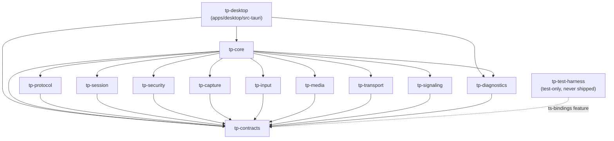

# BOOT-01 — Dependency Map

| Field | Value |
|---|---|
| Phase | BOOT-01 |
| Date | 2026-10-28 |
| Sources | `Cargo.toml` files, `Cargo.lock` (421 packages), `package-lock.json` (239 installed packages), `cargo tree`, `npm ls`, `scripts/license-report.mjs` |
| Diagrams | Mermaid. **Rendering not validated**: no Mermaid tool is installed and none was installed in BOOT-01 |

## 1. Internal crate graph (normal dependencies)

**How the boundary rules are enforced.** The rules come from ARCH-00 §3.3. They are checked on every `cargo test` by `crates/tp-test-harness/tests/workspace_boundaries.rs`, which uses `cargo metadata`:
- The workspace contains exactly the 12 ARCH-00 crates plus `tp-desktop`.
- Every internal edge is on the allowed list. Nothing depends on `tp-test-harness`.
- The internal graph is acyclic.
- Only `tp-desktop` depends on `tauri` or `tauri-build`.
- Platform crates (`tp-capture`, `tp-input`, `tp-media`) have no async runtime.
- Six crates declare `#![forbid(unsafe_code)]`: tp-contracts, tp-protocol, tp-session, tp-signaling, tp-diagnostics and tp-core. The workspace lint denies `unsafe_code` everywhere else.

**Negative control (observed).** I temporarily added `tp-capture → tp-transport`. The test failed with "tp-capture -> tp-transport (normal) is not allowed". After the revert it passed, and `Cargo.lock` was unchanged. Evidence: `docs/qa/evidence/BOOT-01/negative-controls/boundary-violation.log`.

**Edges declared but not yet exercised.** ARCH-00 also allows `tp-session`, `tp-security`, `tp-transport` and `tp-signaling` to depend on `tp-protocol`. Those edges will be added when the crates gain functionality.

## 2. Direct external dependencies

### 2.1 Rust

| Crate | Locked version | License | Used by | Why |
|---|---|---|---|---|
| tauri | 2.12.5 | Apache-2.0 OR MIT | tp-desktop (dev-dep adds the `test` feature) | Desktop shell |
| tauri-build | 2.7.4 | Apache-2.0 OR MIT | tp-desktop (build) | Context codegen, ACL generation, Windows resources |
| serde | 1.0.229 | MIT OR Apache-2.0 | tp-contracts, tp-protocol, tp-desktop | Serialization |
| serde_json | 1.0.154 | MIT OR Apache-2.0 | tp-protocol; tests | JSON wire format v1 |
| thiserror | 2.0.21 | MIT OR Apache-2.0 | tp-protocol | Error types (already in Tauri's graph) |
| ts-rs | 12.0.1 | MIT | tp-contracts (optional `ts-bindings`), tp-test-harness | TypeScript generation, **not linked into the app** |

Resolved transitive versions of note: tauri-runtime-wry 2.12.3, wry 0.57.1, tao 0.37.2, webview2-com 0.39.1, tauri-utils 2.10.2, tokio 1.54.1, windows 0.62.2.

### 2.2 npm (`apps/desktop`, exact versions via `--save-exact`)

| Package | Version | License | Kind |
|---|---|---|---|
| react / react-dom | 19.3.1 | MIT | runtime (in bundle) |
| @tauri-apps/api | 2.12.4 | Apache-2.0 OR MIT | runtime (in bundle) |
| @tauri-apps/cli | 2.12.4 | Apache-2.0 OR MIT | dev |
| vite | 8.3.5 | MIT | dev |
| @vitejs/plugin-react | 6.1.2 | MIT | dev |
| typescript | 6.0.3 | Apache-2.0 | dev |
| tailwindcss / @tailwindcss/vite | 4.3.3 | MIT | dev |
| vitest | 5.0.5 | MIT | dev |
| jsdom | 30.1.3 | MIT | dev |
| @testing-library/react / dom | 16.3.3 / 10.4.2 | MIT | dev |
| eslint / @eslint/js | 10.13.0 / 10.0.1 | MIT | dev |
| typescript-eslint | 8.72.1 | MIT | dev |
| eslint-plugin-react-hooks | 7.1.1 | MIT | dev |
| globals | 17.13.0 | MIT | dev |
| @types/react / @types/react-dom | 19.3.0 | MIT | dev |

**Before installation:**
- No direct dependency was deprecated (`npm view … deprecated`).
- No Tauri plugin is installed, so `shell`, `fs`, `http` and the rest are absent from the build.
- `npm audit` after installation reported **0 vulnerabilities** (`docs/qa/evidence/BOOT-01/npm-audit.log`).

## 3. Compatibility checks performed

| Check | Observed result | Decision |
|---|---|---|
| Latest Tauri crate | `cargo info tauri` → **3.0.0-alpha.5**; `cargo info tauri@2` → **2.12.5** | Stable 2.x chosen; alpha rejected |
| Tauri crate ↔ JS packages | `@tauri-apps/cli` and `@tauri-apps/api` latest = 2.12.4 (dist-tag `next` = 3.0.0-alpha) | Same 2.12 minor on both sides; `tauri info` lists the matching versions |
| Tauri MSRV | tauri 2.12.5 needs rust-version 1.90 | Workspace `rust-version = "1.90"`; toolchain 1.99.1 |
| TypeScript ↔ typescript-eslint | typescript-eslint 8.72.1 peer `typescript >=4.8.4 <6.1.0`; npm latest TypeScript is 7.0.2 | **TypeScript 6.0.3** chosen (7.x unsupported by the linter) |
| ESLint plugins ↔ ESLint 10 | typescript-eslint peer `eslint ^8.57 \|\| ^9 \|\| ^10`; react-hooks peer includes `^10.0.0` | ESLint 10.13.0 |
| Vite 8 consumers | @vitejs/plugin-react 6.1.2 peer `vite ^8`; vitest 5.0.5 peer `vite ^6.4 \|\| ^7 \|\| ^8`; @tailwindcss/vite peer includes `^8` | Vite 8.3.5 |
| Node engines | vite `^20.19 \|\| >=22.12`; vitest `^22.12 \|\| ^24 \|\| >=26`; jsdom `^24.15.0` on the 24 line | Node 24.19.0 (installed) satisfies all of them; Node was not upgraded |
| ts-rs API | Read from the ts-rs 12.0.1 source: `TS::export_to_string(&Config)`, `TS::output_path()`, `Config::new()` | Generator written against the verified API |
| Tauri test helpers | Read from the tauri 2.12.5 source: `tauri::test::{mock_builder, get_ipc_response, INVOKE_KEY}`; `generate_context!` accepts the real config with the mock runtime | IPC/ACL tests use the real capabilities |

## 4. Transitive license inventory (U-15)

Generated by `npm run licenses` → `docs/qa/evidence/BOOT-01/licenses/license-inventory.{md,json}`. Rust scope is resolved per package with `cargo tree -p tp-desktop`, because `cargo metadata` unifies features across the workspace and would wrongly count harness-only crates as shipped.

| Scope | Packages | Preferred (MIT / Apache-2.0 / BSD / ISC) | Other permissive (Zlib, Unicode-3.0, 0BSD, BSL-1.0, CC0, Unlicense, BlueOak) | Flagged for review |
|---|---|---|---|---|
| Rust: linked into `tp-desktop.exe` | 129 | 113 | 15 | **1** |
| Rust: build-time only (build scripts, proc-macros) | 92 | 84 | 4 | 4 |
| Rust: dev/test only (e.g. ts-rs, tauri `test` feature) | 24 | 23 | 1 | 0 |
| npm: shipped in the frontend bundle | 4 | 4 | 0 | 0 |
| npm: dev / build tooling | 230 | 220 | 5 | 5 |

**No GPL, AGPL or LGPL license was found in any scope.**

### 4.1 Flagged items (review, not rejected)

| Package | License | Scope | How it enters | Note for review |
|---|---|---|---|---|
| option-ext 0.2.0 | MPL-2.0 | **Linked into the app** | tauri → dirs 7.0.0 → dirs-sys 0.5.0 → option-ext | Weak, file-level copyleft. Used unmodified. Typical obligations are to keep the notice and make the MPL source available (it is published on crates.io). Part of Tauri's own dependency graph, so technically necessary. **Needs a legal decision before any distribution (REL-09).** |
| cssparser 0.37.0, cssparser-macros 0.7.1, selectors 0.38.0, dtoa-short 0.3.5 | MPL-2.0 | Build-time only | tauri-build / tauri-codegen / tauri-macros → tauri-utils 2.10.2 → dom_query 0.28.0 | Run at compile time for HTML/CSP processing. Not linked into `tp-desktop.exe` (`cargo tree -e normal,no-proc-macro` prints nothing for them) |
| lightningcss 1.32.0 / 1.33.0 (and the `-win32-x64-msvc` binaries) | MPL-2.0 | npm dev tooling | Tailwind CSS v4 / Vite CSS pipeline | Build tool only; its output CSS is ours |
| caniuse-lite 1.0.30001819 | CC-BY-4.0 | npm dev tooling | Browser-support data for build tools | Data, build-time only; attribution license |

This inventory is an engineering record. **It is not a legal compliance certification.**

## 5. Licensing items still unresolved (U-15)

| Item | Status |
|---|---|
| Legal owner / entity of TP Remote | Unknown. `LICENSE.txt` says "legal entity to be confirmed" |
| Whether MPL-2.0 (option-ext) is acceptable for future distribution | Open, for legal review before REL-09 |
| Third-party notices file for distributed builds | Not created (no distribution in BOOT-01); due in REL-09 |
| Automated license gate | Report only, no failing gate. `cargo-deny` was not installed (not approved); proposed for a later phase |
| Rust advisory audit (`cargo audit`) | Not run: tool not installed (not approved). npm audit: 0 vulnerabilities |
