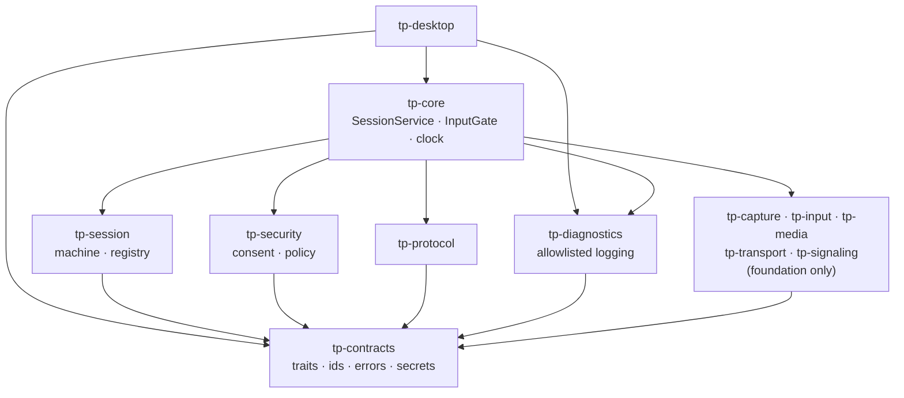

# BOOT-02 — Contract Map

| Field | Value |
|---|---|
| Phase | BOOT-02 |
| Date | 2026-10-28 |
| Scope | Shared contracts (`tp-contracts`), lifecycle (`tp-session`), security policy (`tp-security`), integration (`tp-core`), logging (`tp-diagnostics`), protocol error mapping (`tp-protocol`) |
| Diagrams | Mermaid. **Rendering not validated** (no Mermaid tool installed) |

**Status labels:**

| Label | Meaning |
|---|---|
| IMPLEMENTED | Real code exists |
| TESTED | Executed tests cover it (Windows host, engine level) |
| UNVERIFIED | Not proven on a real OS adapter or device |
| FUTURE | Not written yet; owning phase given |

## 1. Contracts (ARCH-00 §4)

All traits live in `tp-contracts` and use generics and associated types, not trait objects. **Interface availability is not implementation availability:** apart from `SessionManager`, none of these traits has a production implementation, and the boundary test `no_production_platform_implementation_exists_yet` fails if one appears.

| Contract | Module | Status | Production implementation | Key semantics |
|---|---|---|---|---|
| `CaptureProvider`, `CaptureStream`, `FrameSink<F>` | `capture` | Interface IMPLEMENTED + TESTED (compiles, implementable) | FUTURE: CAP-02 (`tp-capture`) | `type Frame` (platform payload) and `type Stream`. `start` returns a caller-owned stream; `stop(self)` is bounded; `Drop` is the last resort. The sink never blocks. Must report `Availability` honestly and fail with `PlatformUnavailable` / `PermissionDenied` instead of returning a dummy stream. Called only after authorization (tp-core) |
| `InputController` | `input` | Interface IMPLEMENTED + TESTED | FUTURE: CTRL-05 (`tp-input`) | Takes an `InjectableEvent` (OS coordinates). `release_all` is idempotent and runs on every teardown. **Only `tp-core::gate::InputGate` may call `inject`** (boundary test) |
| `VideoEncoder`, `VideoDecoder` | `codec` | Interface IMPLEMENTED + TESTED | FUTURE: VID-04 (`tp-media`) | `type Input` pairs with `CaptureProvider::Frame` at compile time. Output goes into a caller-owned `Vec` so buffers are reused. `EncodedFrame` `Debug` shows the length only |
| `Transport`, `TransportSession`, `SignalingLink` | `transport` | Interface IMPLEMENTED + TESTED | FUTURE: NET-03 (`tp-transport`, U-01) | Runtime-agnostic: `impl Future + Send`, no executor dependency. `establish` must observe `CancelToken`. Events are pulled (`poll_event`, sans-IO friendly). `remote_fingerprint` exists for the D-10 check. `ControlMessage` `Debug` is redacted |
| `PermissionManager` | `permission` | Interface IMPLEMENTED + TESTED | FUTURE: CAP-02 / CTRL-05 (macOS) | Status is re-queried on every call; `request` only shows OS prompts and never automates or bypasses them. Windows: `NotApplicable` |
| `DeviceIdentity` | `identity` | Interface IMPLEMENTED + TESTED | FUTURE: NET-03 (U-16) | Domain-separated signatures (`SignContext::label`); the private key never leaves the implementation |
| `SessionManager` | `session` | **IMPLEMENTED + TESTED** by `tp_core::service::SessionService` | — | Synchronous, `&mut self` (ADR-003 C-10). `type ConsentProof = tp_security::LocalConsent`. `disconnect` is idempotent and rejects stale references |

## 2. Shared primitives

| Primitive | Module | Status | Notes |
|---|---|---|---|
| `SessionId`, `DeviceId`, `Generation`, `SessionRef` | `id` | IMPLEMENTED + TESTED | Text form is exactly 32 lowercase hex characters; all-zero is rejected (also via serde). `Debug` shows an 8-character tag only. Production `SessionId` source: FUTURE (CSPRNG, NET-03) |
| `MonoTime`, `Clock` | `time` | IMPLEMENTED + TESTED | Every time decision takes `now`; `tp_core::clock::MonotonicClock` is the production clock |
| `Secret<T: Wipe>` | `secret` | IMPLEMENTED + TESTED | No `Display`, `Serialize`, `Clone` or `PartialEq` (compile-fail doctests). `Debug` prints `Secret(<redacted>)`. Drop wipes **best-effort** (UNVERIFIED against compiler or allocator copies) |
| `ErrorCategory` (13), `ErrorClass`, `CoreError`, `PublicError` | `error` | IMPLEMENTED + TESTED | Static context only. `public()` exposes category, class and a fixed message |
| `Capability`, `Scope`, `Availability`, `PlatformCapabilities` | `capability` | IMPLEMENTED + TESTED | Typed; unknown wire names are rejected. `tp_core::platform_capabilities()` = `NONE` |
| `CancelToken` | `cancel` | IMPLEMENTED + TESTED | Cooperative; parent → children only |
| Lifecycle types (`SessionState`, `EndReason`, `Escalation`, `SessionSnapshot`, …) | `session` | IMPLEMENTED + TESTED | Transitions are defined only in `tp-session` |

## 3. Lifecycle, policy and integration

| Component | Crate | Status | Notes |
|---|---|---|---|
| `SessionMachine` (8 states, timers, effects, typed rejections) | tp-session | IMPLEMENTED + TESTED | ADR-003. Pure: no I/O, no clock |
| `SessionRegistry`, `SharedRegistry`, audit trail | tp-session | IMPLEMENTED + TESTED | One active session; stale-reference rejection; mutex-serialized concurrency |
| `AuthenticatedPeer`, `LocalConsent` | tp-security | IMPLEMENTED (types) | **No production constructor.** `for_tests` exists behind `test-support` only (boundary test: never in the app build) |
| `ConsentGrant`, `authorize`, `Permit`, `DenyReason` | tp-security | IMPLEMENTED + TESTED | Default-deny; an 8-step evaluation order (policy.rs) |
| `SessionService` | tp-core | IMPLEMENTED + TESTED | Registry + peer + grant + platform behind `SessionManager`; logs every transition, rejection and denial |
| `InputGate<C>` | tp-core | IMPLEMENTED + TESTED (mock controller) | Authorizes every event; nothing is cached; denies everything with the production platform |
| Structured logging and redaction | tp-diagnostics | IMPLEMENTED + TESTED | Allowlisted keys, typed values, scrubber safety net, `MemorySink` / `StderrSink` |
| `From<ProtocolError> for CoreError` | tp-protocol | IMPLEMENTED + TESTED | Drops peer-supplied text |
| Trusted local consent surface | — | **FUTURE** (NET-03, U-06) | See BOOT-02-security-review §3 |
| PAKE / handshake producing `AuthenticatedPeer` | — | FUTURE (NET-03, U-03) | — |

## 4. Dependency picture (internal, normal edges)

- `tp-session` and `tp-security` do **not** depend on each other. Their only meeting point is `tp-core`, which is the single place where lifecycle state and authorization are combined.
- Dev-only edges: `tp-core` enables `tp-session/test-support` and `tp-security/test-support` for its tests.

## 5. Contract changes in BOOT-02 (relative to ARCH-00 §4 sketches)

| Change | Reason |
|---|---|
| `SessionManager` is synchronous, with `type ConsentProof` | Determinism, serialized ownership, unforgeable consent (ADR-003 C-10) |
| Capture/codec use associated frame types instead of `FrameData::Gpu/Cpu` enums | No trait objects; compile-time pairing of capture and encoder |
| `VideoEncoder::encode` writes into `&mut Vec<EncodedFrame>` | Buffer reuse |
| `Transport::establish` returns `impl Future + Send`; events are polled | Runtime-agnostic, sans-IO friendly |
| `DisplayInfo::scale_milli: u32` instead of `f32` | `Eq`/`Hash`, no NaN |
| `AuthorizationPolicy` trait → pure function `tp_security::authorize` | Simplest auditable form; no dynamic dispatch |

## 6. Handoff: what CAP-02 capture implementations must satisfy

1. Implement `CaptureProvider` in `tp-capture` (`windows/`, `macos/`, cfg-gated), with `type Frame` = the platform frame (a D3D11 texture handle wrapper, or an IOSurface-backed `CVPixelBuffer` wrapper). `unsafe` is confined there.
2. `capabilities()` must report `Availability` truthfully: `Unavailable(PermissionDenied)` when Screen Recording is denied, and `NotImplemented` on platforms without a backend.
3. `displays()` returns `DisplayLayout` with an incrementing `epoch`, geometry in the OS coordinate space (ARCH-00 §8), and sanitized names.
4. `start(config, sink)` delivers `FrameMeta` + frame from a provider thread. Never block in the sink (latest-wins), never panic across FFI (`catch_unwind`), and report `CaptureEvent::{LayoutChanged, PermissionRevoked, Stopped, Failed}`.
5. `CaptureStream::stop(self)` is bounded, and `Drop` stops capture if `stop` was not called.
6. Never log frame contents. `FrameMeta` is the only loggable data.
7. Calls are made by `tp-core` only after `SessionService::authorize(…, Capability::ViewScreen, …)` allows them. `platform_capabilities()` must be changed deliberately, and the boundary test `no_production_platform_implementation_exists_yet` updated, when the provider lands.
8. For macOS: `PermissionManager` status is re-queried each time, a "requires relaunch" state is handled, and nothing automates System Settings.
