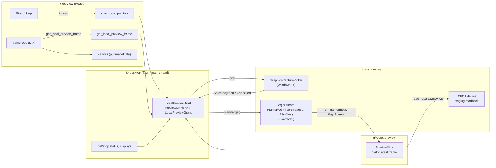
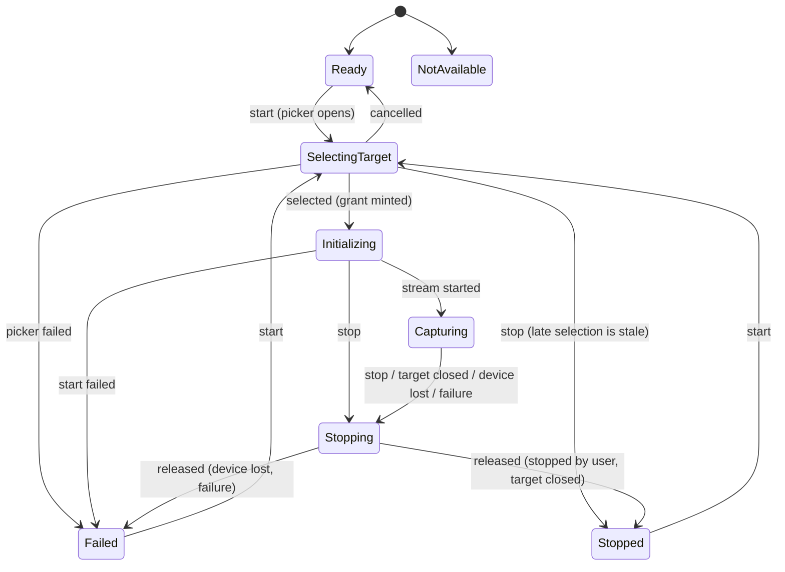

# CAP-02A — Windows capture pipeline and local preview

| Field | Value |
|---|---|
| Phase | CAP-02A |
| Scope | Windows.Graphics.Capture provider (`tp-capture::wgc`), local self-preview (`tp-core::preview`), Tauri commands, UI |
| Decisions | ADR-007 (local preview authorization, capture contract amendment) |
| Status legend | IMPLEMENTED · TESTED (automated) · VERIFIED (real device) · UNVERIFIED · FUTURE |

## 1. Components

| Component | Status | Notes |
|---|---|---|
| WGC support detection (`GraphicsCaptureSession::IsSupported`) | IMPLEMENTED, TESTED, VERIFIED | `true` on DEV-W1 |
| Monitor enumeration (GDI + HiDpi), layout epochs | IMPLEMENTED, TESTED, VERIFIED | 3 × 1920×1080, negative origins |
| System picker (`GraphicsCapturePicker` + `IInitializeWithWindow`) | IMPLEMENTED, TESTED (owner checks); VERIFIED: see test results | |
| Capture session, free-threaded frame pool, BGRA8 | IMPLEMENTED, VERIFIED | Real frames of the test pattern and all monitors |
| Resize (`Recreate`), target closed (event + watchdog), device lost (detection) | IMPLEMENTED; resize and close VERIFIED; device loss TESTED (engine level), UNVERIFIED on the device | |
| CPU readback and area-average downscale | IMPLEMENTED, TESTED, VERIFIED | Pixel colours checked against the test pattern |
| Local preview host, grant, lifecycle | IMPLEMENTED, TESTED | Exhaustive machine exploration |
| UI preview, status, stats | IMPLEMENTED, TESTED (Vitest); VERIFIED: see test results | |
| macOS (ScreenCaptureKit) | FUTURE (CAP-02B) | `tp-capture::unsupported` reports `NotImplemented` |
| Remote streaming, encoder, transport | FUTURE (NET-03, VID-04) | Not reachable from anything here |

## 2. Threads and ownership

| Context | Runs | Owns / touches |
|---|---|---|
| Tauri main thread (STA, message pump) | All six IPC commands (synchronous commands) | Calls `LocalPreview::start`, which opens the picker: the picker needs the owner window's UI thread |
| WinRT completion thread | Picker result (`IAsyncOperation::when`) | `on_picked`: checks the generation, mints the grant, spawns the starter |
| `tp-preview-start` (short-lived) | `provider.start(target)` | Creates the D3D11 device, frame pool and session; then publishes the stream or releases it if stopped meanwhile |
| WGC thread pool | `FrameArrived`, `Closed` | Under `Shared::delivery`: `TryGetNextFrame`, metadata, sink call, `Recreate` on resize. Wrapped in `catch_unwind` |
| `tp-wgc-watchdog` (one per run) | Every 250 ms: does the item still have a size? | Reports `TargetClosed` (WGC's `Closed` event was not raised on DEV-W1) |
| `tp-preview-end` (short-lived) | Provider-initiated ends | Stops the stream outside the provider callback (a sink never stops its own stream) |

- **Lock order:** host `state` before host `frames`. The provider's `delivery` lock is held during a sink call; the sink takes only `frames`, and never while reading pixels.
- **`stop`:** clears the sink under `delivery`, which waits for at most one in-flight readback. It then joins the watchdog and closes the session and pool. Nothing is delivered after `stop` returns; this is tested on the device with the "deliveries after stop" counter.

## 3. Frame path and memory bounds

| Stage | Bound | Drop strategy |
|---|---|---|
| WGC frame pool | 2 BGRA8 buffers of the target size | The OS skips frames if both are in use (not observable) |
| `WgcFrame` | Held only during one sink call; `Close()` on drop | — |
| Readback | One staging texture per run, reused; resized only when the content size changes | Readback only when the slot is empty and ≥ 33 ms since the last one (≤ 30/s) |
| Preview slot | One frame: 24-byte header + ≤ 1280×720×4 bytes (≈ 3.7 MB) | While the slot is full, new frames are counted as `skipped` and not read back |
| IPC response | The slot's buffer is moved, not copied, into the response | The UI requests the next frame only after drawing the previous one |
| Canvas | One `ImageData` per drawn frame | — |

**Frame header** (`tp_contracts::ipc::preview_frame`), little-endian:

| Offset | Field |
|---|---|
| 0 | `TPF1` (magic) |
| 4 | `generation` (u32) |
| 8 | `seq` (u32) |
| 12 | `width` (u32) |
| 16 | `height` (u32) |
| 20 | reserved |
| 24… | RGBA pixels |

`width = 0` means "no new frame". Both Rust and TypeScript test against the same header fixture.

## 4. Metadata and measurements

| Value | Source | Notes |
|---|---|---|
| `FrameMeta.captured_at` | `Direct3D11CaptureFrame.SystemRelativeTime` (QPC, 100 ns) → µs | Real OS timestamp, never synthesised |
| `seq` | Provider counter, contiguous from 1 per run | Checked contiguous on the device |
| `size` | `ContentSize` clamped to the pool size | Changes after `TargetResized` |
| Capture FPS (UI) | Frames received from Windows in the last second (host monotonic clock) | 0 until 250 ms of samples exist |
| Preview FPS (UI) | Frames the canvas drew in the last second (measured in the WebView) | Distinct from capture FPS by design |
| Preview served FPS | Frames handed to the UI per second (host) | Logged as `preview_fps` |
| `skipped` | Frames not previewed because the UI had not taken the previous one | Pipeline backpressure |
| `dropped` | Frames the provider discarded (after stop began) | OS-internal drops are not observable |
| Bench intervals | OS timestamps (`captured_at`) | `capture-bench` |

## 5. Lifecycle

Every event carries the request generation. A stale or out-of-order event is rejected, counted and logged. The exhaustive exploration (`tp-core/tests/preview_machine.rs`) checks six invariants on every edge of every reachable configuration.

## 6. Failure handling

| Condition | Detection | Result |
|---|---|---|
| Picker cancelled | Null item / `ERROR_CANCELLED` | `Ready`, outcome `cancelled`, nothing captured |
| Owner window not ours / invalid | `IsWindow` + process id | `Forbidden`; no picker object is created |
| Target already gone | Item size 0 at start | `PlatformUnavailable` error, `Failed` |
| Target closed while capturing | `Closed` event or watchdog (size 0) | `Stopped`, outcome `targetClosed` |
| Target resized | `ContentSize` ≠ pool size | `Recreate`, `TargetResized`, frames take the new size |
| Device removed/reset | `GetDeviceRemovedReason` after a failed `TryGetNextFrame`, `Map` or `Recreate` | `Failed`, outcome `deviceLost`; restarting creates a new device |
| Readback failure | `read_rgba` error | `Failed` |
| Panic in a callback | `catch_unwind` | `Failed(InternalError)`; never unwinds into WinRT |
| App closes while capturing | `RunEvent::ExitRequested` / `Exit` → `stop()` | Capture released before exit |

## 7. Monitor identity (validated on DEV-W1)

| GDI device | Virtual-desktop origin | WGC item name | Primary |
|---|---|---|---|
| DISPLAY1 | (−1920, 71) | Display 2 | no |
| DISPLAY2 | (−3840, 71) | Display 1 | no |
| DISPLAY3 | (0, 0) | Display 3 | yes |

GDI numbering, WGC numbering and physical left-to-right order are all different. None of them is a stable hardware identity. Evidence: `docs/qa/evidence/CAP-02A/provider/diagnostic-names-and-close.log`.

## 8. Recursion (mirror effect)

If the TP Remote window is on the captured display, the preview shows the preview. This is expected behaviour, not an engine fault, and the UI says so for display targets. QA placed TP Remote and the captured content on different monitors.

## 9. Observed OS behaviour: covered windows deliver no frames

**Observed on DEV-W1 (Windows 11 build 26100, NVIDIA driver 32.0.16.1088):**
- A GDI test-pattern window kept repainting about 64 times per second.
- Window capture of it stopped receiving frames 2–4 s after start, apparently when other windows covered it.
- New capture sessions on the same covered window received **no frame at all**, not even WGC's usual initial frame.
- With the window kept topmost, capture ran at 52–58 fps for the whole run, and start/stop cycles were reliable.

| Run | Window | Result | Evidence |
|---|---|---|---|
| diag-A | normal z-order, no readback | 216 frames, then 0 for 26 s while repainting continued | `perf/diag-A-no-readback.jsonl` (`pattern_paints`) |
| diag-B | normal, readback, 3 cycles | cycle 1 stalls after 78 frames; cycles 2–3 no frames | `perf/diag-B-readback-cycles.jsonl` |
| diag-C | topmost, no readback | 1,084 frames in 20 s (54.2 fps) | `perf/diag-C-topmost-no-readback.jsonl` |
| diag-D | topmost, readback, 3 cycles | 262 / 271 / 262 frames, first frame 156–203 ms | `perf/diag-D-topmost-readback-cycles.jsonl` |

**Interpretation:**
- What triggers the stall is the window being covered (z-order). Readback is not involved: diag-A had none.
- The exact DWM/WGC mechanism is **UNVERIFIED**, and so is whether it also affects windows that present with DirectX/flip-model.
- Display targets are unaffected: a display has no z-order.

**Consequences:**
- A picked *window* that the user covers with another window freezes in the preview. Capture FPS then honestly drops to 0, and the run keeps going: this is not reported as an error.
- QA and the bench keep the synthetic window topmost. The first two bench runs (`bench-1080p-window-to-720p`, `bench-10-cycles`) were affected and are **not used** as performance results; their logs stay in the evidence as found.
