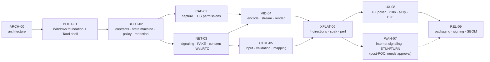

# TP Remote — Prompt Roadmap (ARCH-00 … REL-09)

| Field | Value |
|---|---|
| Status | Draft (ARCH-00). Each phase starts only after the user approves the previous phase's report. |
| Date | 2026-10-28 |
| Related | [ARCH-00](../architecture/ARCH-00.md) · [Test matrix](../qa/TEST-MATRIX.md) · [Test strategy](../qa/TEST-STRATEGY.md) · [Threat model](../security/THREAT-MODEL.md) |

---

## 1. Global rules (they apply to every phase prompt)

1. **One phase per prompt.** Never start the next phase automatically. End each phase with `docs/reports/<PHASE>-report.md` and STOP.
2. **File ownership.** A phase may create or modify only:
   - the files listed under "Files/modules owned";
   - its own report;
   - `docs/qa/results/<PHASE>-results.md` and `docs/qa/evidence/<PHASE>/**`;
   - documentation updates explicitly listed in the phase.

   Any other change must appear in the report under **"Out-of-scope changes"** with a justification, and needs the user's approval before the work is merged into the baseline. The default expectation is "none".
3. **Contracts.** Changes to `tp-contracts` types or traits after BOOT-01 must be listed under **"Contract changes"**: what changed, why, and which modules are affected. Any change that affects security gates (§6.6 of ARCH-00) also needs a threat-model update.
4. **Dependencies.** For every new dependency (crate or npm package), the report lists name, exact version, license, purpose, the compatibility-check command and its output (T-STA-07), and the advisory/license check result (T-STA-05/06). No dependency is pinned without that check. Installing system tools (toolchains, CLIs, drivers) needs **explicit user approval in the prompt or the conversation**.
5. **Deferred work.** Work discovered that belongs to another phase is logged under **"Deferred"**, with its target phase. It is not implemented.
6. **Evidence and honesty.** Results follow TEST-STRATEGY §9. Every BLOCKED test names its blocker. Never fabricate results, environment facts or measurements.
7. **Platform rule.** A phase may not claim macOS results without a macOS run, nor Windows results without a Windows run.
8. **Verdict.** PASS / PARTIAL / FAIL / BLOCKED per TEST-STRATEGY §10. A PARTIAL verdict lists each carry-forward item and needs the user's acknowledgement before the next phase.
9. **No commit, push, deploy or release** unless the user explicitly asks in that phase. The workspace is currently not a git repository; running `git init` also requires approval (proposed for BOOT-01).
10. **Forbidden in every phase unless explicitly approved:**
    - changing firewall, router or OS security settings;
    - opening public ports;
    - cloud deployment;
    - elevation, services or autostart;
    - disabling OS indicators;
    - unattended access;
    - storing or logging secrets;
    - persisting frames.

### 1.1 Phase report template (required sections)

1. Executive summary
2. Files created or modified
3. Out-of-scope changes (expected: none)
4. Contract changes
5. Dependencies added (with version, license, check output)
6. Commands executed and their actual results
7. Tests: PASS / FAIL / BLOCKED / NOT RUN, with evidence paths
8. Security notes and threat-model deltas
9. Deferred items
10. Risks and blockers
11. Verdict
12. Readiness for the next phase

### 1.2 Phase dependency graph



CAP-02 and NET-03 may run in either order after BOOT-02. They do not share owned files.

> **Amendment (BOOT-02, 2026-10-28):**
> - BOOT-02 was inserted after BOOT-01. It holds the BOOT-01 scope that the BOOT-01 prompt deferred: the contracts, the state machine, the policy and redaction.
> - ADR numbers: ADR-003 is the session lifecycle and ADR-004 the platform support policy (U-08). The NET-03 session-security ADR is renumbered **ADR-005**, and the WAN-07 ADR **ADR-006**.

> **Amendment (CAP-02A, 2026-10-28):**
> - CAP-02 is split. **CAP-02A** is Windows native capture plus a local self-preview (§4a). **CAP-02B** is macOS ScreenCaptureKit plus OS permissions; it needs DEV-M1.
> - The local preview ships in the normal build behind the Windows picker, not as a dev-only preview. ADR-007 covers its authorization; ADR-005 and ADR-006 stay reserved.

### 1.3 Hardware and access prerequisites (cross-phase)

| Need | By phase | Status |
|---|---|---|
| Rust toolchain (rustup, stable MSVC) on DEV-W1 | BOOT-01 | **Missing. User approval needed to install** |
| ≥ 1 Apple Silicon Mac with Xcode / Command Line Tools | CAP-02 | **Not available** |
| Second Windows device (DEV-W2) | NET-03 | **Not available** |
| Second Mac (DEV-M2) | XPLAT-06 | **Not available** |
| ≥ 120 fps camera for glass-to-glass latency | VID-04 | Unknown |
| NET-LAB (switch; optional Linux `tc netem` box) | NET-03 / VID-04 | Unknown |
| Code-signing certificate, Apple Developer Program | REL-09 | Unknown |
| WAN infrastructure approval (U-14) | WAN-07 | Not approved (outside the POC) |

---

## 2. ARCH-00 — Architecture, scope, security and QA baseline (this phase)

| Item | Content |
|---|---|
| Goal | Agree on the architecture, contracts, security model, test strategy and roadmap before any code |
| Scope | Read-only environment audit; the 8 documents in `docs/` |
| Non-goals | Any application code, dependency installation, builds |
| Files owned | `docs/architecture/ARCH-00.md`, `ADR-001-stack.md`, `ADR-002-media-transport.md`, `docs/security/THREAT-MODEL.md`, `docs/qa/TEST-STRATEGY.md`, `docs/qa/TEST-MATRIX.md`, `docs/roadmap/PROMPT-PLAN.md`, `docs/reports/ARCH-00-report.md` |
| Dependencies | None |
| Steps | Audit → design → feasibility analysis → threat model → test plan → roadmap → report |
| Test commands | None (documentation phase) |
| Manual validation | The user reviews the documents for consistency and scope |
| Acceptance criteria | All 8 documents exist and are mutually consistent; high-risk assumptions are marked; the test matrix and exit gates are complete; no implementation and no system changes |
| Exit gate | User approval of the ARCH-00 report, plus decisions or acknowledgement of U-08, U-09 and U-15, and approval to install Rust (R-01) |
| Risks / blockers | R-01, R-02, R-03 |

---

## 3. BOOT-01 — Monorepo scaffold, contracts, state machine, static gates

| Item | Content |
|---|---|
| Goal | A compiling workspace with the contracts, a fully tested session state machine, protocol skeleton, diagnostics/redaction, a mock-driven Tauri shell, and all static and unit gates runnable locally |
| Scope | Cargo workspace; `tp-contracts` (all §4 traits and types); `tp-session` (complete state machine + timers, FakeClock); `tp-protocol` (envelope, version negotiation, decoding limits, input-event types and validation skeleton); `tp-diagnostics` (tracing + redaction + gauges); `tp-test-harness` (fakes: SyntheticCapture, MockInput, Passthrough codec, LoopbackTransport stub, FakeClock); `tp-core` (wiring with fakes, input-gate skeleton); empty-but-compiling `tp-capture`, `tp-input`, `tp-media`, `tp-transport`, `tp-signaling`, `tp-security`, each with a README of its boundary rules and mock implementations only; Tauri 2 app (`apps/desktop`) with React + TS + Tailwind: Home / Host / Connect / Session screens driven by a **mock** session; `core-api/` wrapper; Vitest; Playwright skeleton; `scripts/check.*`, `scripts/boundaries.*`; `deny.toml`, `rustfmt.toml`, `rust-toolchain.toml`, `.editorconfig`, `.gitignore` |
| Non-goals | Real capture, input, codecs, networking or PAKE; platform FFI; packaging; any UI polish beyond functional screens |
| Files / modules owned | Root: `Cargo.toml`, `Cargo.lock`, `rust-toolchain.toml`, `deny.toml`, `rustfmt.toml`, `clippy.toml` (optional), `package.json`, `package-lock.json`, `.editorconfig`, `.gitignore`. `scripts/**`. `apps/desktop/**`. `crates/*/` (all, scaffold level) |
| Dependencies | ARCH-00 approved; **Rust installed (approval)**; U-05, U-09, U-13 and U-15 decided at the start of BOOT-01 |
| Implementation steps | 1. Verify the toolchains (`rustc -V`, `cargo -V`, `node -v`, `npm -v`) and record them. 2. Choose dependency versions via registry queries and compatibility checks; record them in the report. 3. Create the workspace and crates per ARCH-00 §3.4. 4. Implement `tp-contracts`. 5. Implement `tp-session`, test-first (T-UNI-01 … 06). 6. `tp-protocol` envelope, limits and validation types (T-UNI-14 … 16). 7. `tp-diagnostics` redaction (T-UNI-18). 8. Fakes in the harness; `tp-core` wiring; queue policies (T-UNI-22, T-INT-01). 9. Scaffold Tauri 2 + React + TS + Tailwind; `core-api/`; commands with mocks; CSP and capabilities. 10. Scripts: check, boundaries, release-config check. 11. Run every gate and record the evidence |
| Test commands | `./scripts/check.ps1` (runs fmt, clippy, cargo test, tsc, eslint, vitest, boundaries, deny/audit if approved); `npm run e2e` (T-UI-01 skeleton); `npm run tauri dev` (manual launch) |
| Manual validation | The app launches on DEV-W1; the mock Host and Controller flows walk the state machine (Idle → … → Connected → Disconnected); the indicator appears in Connected |
| Acceptance criteria | Gate tests listed in TEST-MATRIX §10 for BOOT-01 are PASS on Windows; macOS halves of T-STA-04/07 are either PASS or BLOCKED with the reason; no real platform code; boundaries clean |
| Exit gate | All BOOT-01 gate tests PASS (Windows), or BLOCKED with a recorded waiver; the report is approved |
| Risks / blockers | R-01 (toolchain); Tauri/WebView2 version alignment; WebView2 DPI-awareness default (FS-G) noted for CAP-02 |

---

## 3a. BOOT-02 — Core contracts, session state machine, security gates (inserted; executed 2026-10-28)

| Item | Content |
|---|---|
| Goal | A small, auditable, tested core that future remote features cannot bypass by accident |
| Scope | ARCH-00 §4 contracts in `tp-contracts` (interfaces only); `tp-session` machine, registry and timers (ADR-003); `tp-security` authentication and consent proof types, grants, default-deny policy; `tp-core` `SessionService` and `InputGate`; `tp-diagnostics` allowlisted logging and redaction; cross-platform error model; protocol error mapping; ADR-004 (U-08, provisional) |
| Non-goals | Any capture, input injection, codec, transport, signaling, PAKE, IPC command, OS permission request, network listener or UI change |
| Files / modules owned | `crates/tp-contracts/**`, `crates/tp-session/**`, `crates/tp-security/**`, `crates/tp-core/**`, `crates/tp-diagnostics/**`, `crates/tp-protocol/src/error.rs`, `crates/tp-protocol/tests/reserved.rs`, `crates/tp-test-harness/tests/workspace_boundaries.rs`, `apps/desktop/src-tauri/src/lib.rs` (log field name only), `apps/desktop/src-tauri/tests/ipc.rs` (phase assertion only), BOOT-02 docs and ADR-003/004 |
| Exit gate | BOOT-02 prompt §15. Result: see `docs/reports/BOOT-02-report.md` |

## 4a. CAP-02A — Windows native capture and local preview (executed 2026-10-28)

| Item | Content |
|---|---|
| Goal | Real Windows.Graphics.Capture frames shown live in TP Remote, behind a trusted local selection boundary, with real measurements |
| Scope | `tp-capture::wgc` (picker, monitors, D3D11, stream, readback); capture contract amendment (ADR-007); `tp-core::preview` (machine, grant, host); five Tauri commands; preview UI; `tp-test-harness` real-device tests, `capture-bench`, `preview-soak`, `tp-test-pattern` |
| Non-goals | Remote streaming, encoding, transport, input, macOS, DXGI comparison (U-11) |
| Exit gate | CAP-02A prompt §16. Result: see `docs/reports/CAP-02A-report.md` |

## 4. CAP-02 — Screen capture and OS permissions

| Item | Content |
|---|---|
| Goal | Real `CaptureProvider` implementations for Windows (WGC, plus DXGI evaluation) and macOS (ScreenCaptureKit), with permission handling, measured capture performance and a local-only preview |
| Scope | `tp-capture/windows` (WGC; DXGI spike per U-11); `tp-capture/macos` (ScreenCaptureKit); `tp-security/os_permissions` (`PermissionManager`: ScreenCapture status, request, open settings); `capture-bench` harness binary; UI `PermissionGuide` and a **dev-only** local preview (low rate, in memory, never written to disk); FS-A, FS-B and the capture part of FS-G |
| Non-goals | Encoding, network streaming, input, consent flows (the gate API is only called by tests or the harness) |
| Files / modules owned | `crates/tp-capture/**`, `crates/tp-security/src/os_permissions/**`, `crates/tp-test-harness/src/bin/capture_bench.rs`, `apps/desktop/src/components/PermissionGuide*`, `apps/desktop/src/app/DevPreview*` (dev-only), `docs/reports/CAP-02-capture-spike.md` |
| Dependencies | BOOT-01; **DEV-M1 for macOS**; U-08 decided (minimum macOS version) |
| Implementation steps | 1. Choose binding crates (`windows`, `objc2-*`) with version and license checks. 2. WGC monitor capture → D3D11 frames → FrameSink, keeping the yellow border. 3. Layout changes → epoch. 4. DXGI spike including adapter matching on the hybrid GPU; record the U-11 decision. 5. ScreenCaptureKit capture, own-window exclusion, idle-frame handling. 6. `PermissionManager` for macOS Screen Recording, with Windows returning Granted. 7. `capture-bench` metrics. 8. PermissionGuide UI |
| Test commands | `cargo test -p tp-capture`; `cargo run -p tp-test-harness --bin capture-bench -- …`; `./scripts/check.ps1` / `check.sh` |
| Manual validation | T-DEV-01 … T-DEV-06 on the devices; screenshots of test-pattern previews only |
| Acceptance criteria | Windows: T-DEV-01, 02, 03 and T-INT-02 PASS. macOS: T-DEV-04, 05, 06 and T-INT-02 PASS. T-SEC-01 and T-SEC-18 PASS. Capture fps meets ≥ 29 with animated content |
| Exit gate | **Both OSes PASS.** If no Mac is available, the verdict is PARTIAL and the macOS items carry forward. They must PASS before VID-04 exits |
| Risks / blockers | R-02 (no Mac); R-06 (macOS permission UX); hybrid-GPU adapter issues; Tauri dev-mode TCC "responsible process" behaviour |

---

## 5. NET-03 — Signaling, PAKE, consent and WebRTC transport (LAN)

| Item | Content |
|---|---|
| Goal | An authenticated, consent-gated session over LAN between two TP Remote instances, with WebRTC transport and the `tp-control` DataChannel, using mock media and input |
| Scope | U-01 bake-off (str0m vs webrtc-rs vs libwebrtc) with report `docs/reports/NET-03-webrtc-bakeoff.md`. `tp-transport` (adapter for the chosen library; SimNet; loopback). `tp-signaling` (LAN listener and connector, framing, limits, per-IP rate limits). `tp-security` (DeviceIdentity + keystore (U-16), PAKE + key schedule (U-03), consent broker, AuthorizationPolicy). `tp-protocol` (signaling and control messages). `tp-session` integration. Resume within grace. Minimal ConsentDialog and SessionIndicator UI (security-required; U-06 decided). `evil-client` and `mitm-proxy` harness tools. Fuzz targets (if nightly approved). FS-D and the LAN part of FS-I |
| Non-goals | Real video encoding (pre-encoded synthetic H.264 only, for the bake-off), real input injection (MockInput only), WAN, UI polish |
| Files / modules owned | `crates/tp-transport/**`, `crates/tp-signaling/**`, `crates/tp-security/**` (except `os_permissions`, which CAP-02 owns), `crates/tp-protocol/**`, `crates/tp-session/**` (integration), `crates/tp-core/src/session/**`, `crates/tp-test-harness/src/{evil_client,mitm_proxy,headless}/**`, `fuzz/**`, `apps/desktop/src/components/{ConsentDialog,SessionIndicator}*`, `apps/desktop/src/app/{Host,Connect}*`, `docs/architecture/ADR-005-session-security.md` (new), `docs/security/THREAT-MODEL.md` (update) |
| Dependencies | BOOT-01; **DEV-W2** for the two-device tests; nightly + `cargo-fuzz` (approval) for T-SEC-09; a security review of U-03 |
| Implementation steps | 1. Bake-off spike (FS-D1 … D6) → choose U-01 → update ADR-002. 2. Choose the PAKE crate (U-03); write ADR-005 (key schedule, framing); review. 3. Signaling listener and connector with limits. 4. Handshake → `SessionRequest` / `HostIdentity` → consent broker → `ConsentResult`. 5. SDP over the authenticated channel; DTLS fingerprint double check. 6. `tp-control` channel, heartbeats, link degradation, resume. 7. Consent UI and indicator (UI-03 safety rules). 8. Harness attack tools; fuzz targets. 9. Run the gates |
| Test commands | `cargo test --workspace`; `cargo test -p tp-test-harness --test …` (T-INT-07, 09, 11, 12); `tp-headless host` + `tp-headless controller` (T-INT-06); `cargo +nightly fuzz run …` (T-SEC-09); `npm run e2e -- controller.spec.ts consent.spec.ts` |
| Manual validation | W1 ↔ W2 session with mock media: consent Allow / Deny / timeout, revoke, Busy, adapter-disable reconnect; firewall behaviour (T-NWK-08); listener checks (T-SEC-17) |
| Acceptance criteria | Every NET-03 gate test in TEST-MATRIX §10 passes; the bake-off decision is recorded; the threat model is updated; ADR-005 is approved |
| Exit gate | PASS, or PARTIAL only for device-blocked items (W2) with explicit carry-forward; **no** waiver of T-SEC-03, 08, 12, 13 or 14 |
| Risks / blockers | R-03 (W2), R-04 (library maturity), R-14 (virtual adapters), PAKE crate audit status, U-06 |

---

## 6. VID-04 — Video encode, stream and render

| Item | Content |
|---|---|
| Goal | View-only remote screen over LAN: capture → H.264 → WebRTC → Controller render, with measured FPS and latency against the targets |
| Scope | `tp-media` backends (VideoToolbox, Media Foundation hardware, OpenH264 per the U-04 decision); `tp-core` media pipeline (rate control from the bandwidth estimate, keyframes, queues); Controller render path per U-02 (F-1 WebCodecs first); `apps/desktop/src/media/**`; `latency-probe` and test-pattern tooling; Tauri channel benchmark (FS-F3); FS-E and FS-F |
| Non-goals | Input injection; WAN; audio; recording |
| Files / modules owned | `crates/tp-media/**`, `crates/tp-core/src/media/**`, `crates/tp-transport/src/video/**`, `apps/desktop/src/media/**`, `apps/desktop/src/components/RemoteViewport*`, `crates/tp-test-harness/src/bin/{latency_probe,codec_bench}.rs`, `tools/test-pattern/**`, `docs/reports/VID-04-*.md`, `docs/architecture/ADR-002-media-transport.md` (U-02 and U-04 outcome) |
| Dependencies | CAP-02 and NET-03; legal input on U-04 before any build that bundles OpenH264; a camera for M-02; DEV-M1 for WKWebView |
| Implementation steps | 1. Encoder backends behind the contract (T-INT-03). 2. WebCodecs decode spike in WebView2 and WKWebView (T-INT-04); decide U-02 per platform. 3. Pipeline integration with BWE → `set_rate`. 4. Renderer and frame timing (M-01). 5. Latency instrumentation (M-02) and the test pattern. 6. Measurements on LP-1 … LP-4 |
| Test commands | `cargo test -p tp-media`; `codec-bench`; `latency-probe`; `npm run test -- media` |
| Manual validation | View-only sessions on the available directions; glass-to-glass recordings of the test pattern |
| Acceptance criteria | T-INT-03/04 PASS per platform; T-PRF-01 and T-PRF-02 measured under LP-1 against the targets (a miss needs a "Target revision" section); T-NWK-12 PASS; T-SEC-15 PASS |
| Exit gate | Render path chosen and working on both WebViews (or a fallback implemented); performance evidence recorded; carried-forward CAP-02 macOS items closed |
| Risks / blockers | R-05 (WKWebView), R-08 (licensing), R-10 (latency), MF hardware MFT quirks |

---

## 7. CTRL-05 — Remote input: validation, mapping, injection

| Item | Content |
|---|---|
| Goal | Safe remote control: Controller input → validated → mapped → injected on the Host, only within authorized sessions |
| Scope | Controller `apps/desktop/src/input/**` (pointer and keyboard capture, view mapping, rAF batching, "Send keys" menu, release on blur); `tp-protocol` validation and rate limits (complete); `tp-core::input_gate` + mapping (FS-G); `tp-input/windows` (SendInput) and `tp-input/macos` (CGEvent + Accessibility in `PermissionManager`); keymap single source (FS-H); privileged-UI guard spike (FS-C, TM-12); evaluation of the `tp-motion` channel (ADR-002 §4.2) |
| Non-goals | Text/IME injection, clipboard, file transfer, `uiAccess`, global hooks on the Controller |
| Files / modules owned | `crates/tp-input/**`, `crates/tp-protocol/src/input/**`, `crates/tp-core/src/input_gate/**`, `crates/tp-security/src/os_permissions/input*`, `apps/desktop/src/input/**`, `apps/desktop/src/components/Toolbar*` (Send keys), `docs/reports/CTRL-05-*.md` |
| Dependencies | NET-03 (session and control channel); VID-04 for realistic use (not strictly required for accuracy tests); DEV-M1 |
| Implementation steps | 1. Keymap CSV → generated tables (T-UNI-13). 2. Validation and rate limits (T-UNI-07/08). 3. Mapping functions with fixtures (T-UNI-10 … 12). 4. Windows injector. 5. macOS injector and permission. 6. `release_all` paths (T-UNI-09, T-DEV-16). 7. Privileged-UI guard spike. 8. Security tests |
| Test commands | `cargo test -p tp-input -p tp-protocol -p tp-core`; `npm run test -- input`; harness `evil-client` scenarios |
| Manual validation | T-DEV-07 … T-DEV-10; revoke timing (T-SEC-06) |
| Acceptance criteria | All CTRL-05 gate tests PASS; UIPI and secure-input limitations documented in the UI text |
| Exit gate | PASS on both OSes, or PARTIAL with only device-blocked items; **no** waiver of T-SEC-05 … 07 |
| Risks / blockers | R-07 (UIPI), macOS Accessibility UX, keyboard edge cases |

---

## 8. XPLAT-06 — Cross-platform matrix, stability and performance baseline

| Item | Content |
|---|---|
| Goal | All four directions certified on real devices with full SR checks, stability and performance evidence |
| Scope | Run the T-DEV-11 … T-DEV-17 matrix, T-PRF-07/08 (real), T-NWK-02, the cross-OS keyboard policy decision (U-07), re-runs of every SR test on both OSes. **Bug fixes only**, inside modules already owned by earlier phases; each fix is listed |
| Non-goals | New features, new modules, UI redesign |
| Files / modules owned | `docs/qa/results/XPLAT-06-results.md`, `docs/qa/evidence/XPLAT-06/**`, `docs/reports/XPLAT-06-report.md`. Code fixes are allowed in existing modules but must be listed per file with the defect ID |
| Dependencies | VID-04, CTRL-05; **DEV-W2, DEV-M1, DEV-M2**; NET-LAB |
| Implementation steps | 1. Freeze the build. 2. Run the matrix per direction. 3. Triage defects (S1–S4). 4. Fix S1/S2 and re-run the affected tests. 5. Revise targets if needed (with justification) |
| Test commands | Per TEST-MATRIX; scripted cycles (`tp-headless --cycles 10`) |
| Manual validation | Full manual checklists for each direction |
| Acceptance criteria | DIR-1 … DIR-4 PASS; T-PRF-07 and T-PRF-08 PASS in each direction; performance targets met or revised with approval |
| Exit gate | All four directions PASS; no open S1/S2 |
| Risks / blockers | Device availability (R-02, R-03); scope creep into features (R-15) |

---

## 9. WAN-07 — Internet signaling, STUN/TURN (post-POC; separate approval required)

| Item | Content |
|---|---|
| Goal | Sessions between devices on different networks, with the same authentication and consent guarantees |
| Scope | Rendezvous signaling service (opaque relay of authenticated signaling) and client in `tp-signaling/wan`; STUN/TURN configuration; ephemeral TURN credentials; ICE restart across networks; deployment manifests for a **dev/test** environment only; server threat review |
| Non-goals | Accounts, billing, production deployment, unattended access, address books |
| Files / modules owned | `crates/tp-signaling/src/wan/**`, `services/rendezvous/**` (new), `infra/dev/**` (new), `docs/architecture/ADR-006-wan.md` (new), `docs/security/THREAT-MODEL.md` (update) |
| Dependencies | XPLAT-06; **user approval for infrastructure (U-14)**, because cloud deployment is excluded from the POC; test networks |
| Implementation steps | 1. ADR-006 (hosting, trust, privacy). 2. Rendezvous service. 3. TURN (e.g. coturn) in the dev environment. 4. Client integration. 5. Server MITM test (T-SEC-12 variant). 6. Network tests |
| Test commands | `cargo test -p tp-signaling`; service tests; T-NWK-09 … 11 manual |
| Manual validation | Sessions across two independent networks, including a forced relay |
| Acceptance criteria | T-NWK-09 … 11 and T-SEC-12 (server) PASS; metadata/privacy statement written |
| Exit gate | PASS plus a security review of the deployed dev infrastructure |
| Risks / blockers | Infrastructure approval; cost; NAT diversity in testing |

---

## 10. UX-08 — UX polish, onboarding, accessibility, i18n, E2E

| Item | Content |
|---|---|
| Goal | A clear, safe and accessible user experience for both roles |
| Scope | Permission onboarding (macOS); consent dialog copy and anti-scam warnings (TM-11) after review; session indicator design; Controller toolbar (display switch, Send keys, quality info); error messages; English and Vietnamese i18n; accessibility; Playwright suites T-UI-01 … 05; WebView2 CDP E2E feasibility |
| Non-goals | New engine features; changes to security semantics (any change → threat-model update + approval) |
| Files / modules owned | `apps/desktop/src/**` (UI only, except `media/` and `input/` internals), `apps/desktop/e2e/**`, `apps/desktop/src/i18n/**` |
| Dependencies | XPLAT-06 (stable flows); Playwright and axe tooling (approval) |
| Implementation steps | 1. UX review of consent and indicator. 2. Onboarding. 3. i18n. 4. Accessibility fixes. 5. E2E suites |
| Test commands | `npm run test`; `npm run e2e`; `./scripts/check.*` |
| Manual validation | Walkthroughs on both OSes; review of the scam-warning copy |
| Acceptance criteria | T-UI-01 … 05 PASS; T-SEC-19 PASS; no regression in SR tests |
| Exit gate | PASS |
| Risks / blockers | Copy approval; macOS E2E remains manual |

---

## 11. REL-09 — Packaging, signing, notarization, SBOM

| Item | Content |
|---|---|
| Goal | Signed, verifiable installers for Windows and macOS for internal release, with license compliance |
| Scope | Tauri bundler configuration (NSIS per-user / MSI; DMG); Authenticode signing; macOS Developer ID signing, hardened runtime, minimal entitlements, notarization and stapling; U-10 decision (including the persistent-content-capture entitlement request if chosen); SBOMs; third-party notices; OpenH264 distribution per legal guidance; release checklist; updater only if approved (signed) |
| Non-goals | Public distribution or upload (needs separate approval), auto-start, services |
| Files / modules owned | `apps/desktop/src-tauri/tauri.conf.json` (bundle section), `apps/desktop/src-tauri/{Info.plist,entitlements.plist}`, `release/**` (scripts, checklist), `THIRD-PARTY-NOTICES.md`, `docs/reports/REL-09-report.md` |
| Dependencies | UX-08; **certificates and an Apple account (R-09)**; legal input (U-04, U-15); a clean test VM and a clean test Mac |
| Implementation steps | 1. Bundle configuration. 2. Signing pipeline (secrets kept out of the repository). 3. Notarization. 4. SBOM and notices. 5. Install/uninstall and permission-persistence tests |
| Test commands | `npm run tauri build`; `signtool verify /pa /v …`; `codesign --verify --deep --strict -v …`; `spctl -a -vv …`; `xcrun stapler validate …` |
| Manual validation | T-REL-01 … 07 on clean machines |
| Acceptance criteria | T-REL-01 … 07, T-STA-10, T-SEC-16 and T-SEC-18 PASS |
| Exit gate | PASS plus user approval before any distribution |
| Risks / blockers | Certificates and accounts; SmartScreen reputation; TCC identity resets |

---

## 12. Prompt header template for future phases

Future phase prompts should open with this block. It keeps each phase inside its scope:

```text
PHASE: <ID>                 PREVIOUS PHASE REPORT: docs/reports/<prev>-report.md (approved: yes/no)
GOAL: <from PROMPT-PLAN>
FILES/MODULES OWNED: <from PROMPT-PLAN; anything else = out-of-scope change>
NON-GOALS: <from PROMPT-PLAN>
APPROVED INSTALLS/TOOLS: <explicit list or "none">
DECISIONS REQUIRED AT START: <U-xx list>
EXIT GATE TESTS: <from TEST-MATRIX §10>
DEVICES AVAILABLE: <W1/W2/M1/M2/NET-LAB>
STOP after docs/reports/<ID>-report.md. Do not start the next phase.
```
