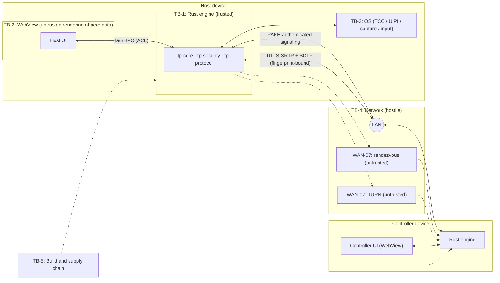

# TP Remote — Threat Model and Mitigation Plan

| Field | Value |
|---|---|
| Status | Draft (ARCH-00). It must be re-reviewed at the exit of NET-03, CTRL-05, WAN-07 and REL-09. |
| Date | 2026-10-28 |
| Method | Asset and actor analysis, trust boundaries, STRIDE per boundary, abuse cases |
| Related | [ARCH-00](../architecture/ARCH-00.md) §6–§9 · [ADR-002](../architecture/ADR-002-media-transport.md) · [Test matrix](../qa/TEST-MATRIX.md) (T-SEC-*) |

---

## 1. Scope and assumptions

**In scope.** The MVP: attended LAN sessions with consent first, in four directions (ARCH-00 §1). WAN-07 additions are covered in §8.8 and §8.9.

**Assumptions:**
- **A1.** The operating systems on both devices are not compromised. Malware with the same user's privileges can already screen-scrape and inject input; TP Remote does not try to defend against it (see TM-15).
- **A2.** The Host user is physically present and able to read the consent prompt.
- **A3.** The Host user passes the one-time code to the intended Controller over a channel they trust, such as a phone call or in person.
- **A4.** Cryptographic primitives from vetted crates are correct. Crate selection is reviewed (U-03).
- **A5.** The network is hostile: on LAN, a passive or active attacker on the same segment; on WAN, untrusted servers in the path.

**Out of scope for the MVP:** physical attacks, a kernel-level adversary, side channels on the device, attacks on OS updates.

## 2. Assets

| ID | Asset | Why it matters |
|---|---|---|
| AS-1 | Host screen content | Confidential information: documents, credentials on screen, personal data |
| AS-2 | Host input control | Full ability to act as the Host user |
| AS-3 | One-time session code | Authenticates the Controller to the PAKE |
| AS-4 | Session keys and resume key | Channel confidentiality and integrity; the ability to resume |
| AS-5 | Device identity private key | Device impersonation and future trust features |
| AS-6 | The consent decision and its scope | The authorization root |
| AS-7 | Logs, diagnostics, crash data | May leak AS-1 … AS-5 or network metadata |
| AS-8 | Build artifacts and dependencies | Supply-chain integrity |
| AS-9 | Network metadata (IPs, timing) | Privacy |

## 3. Actors

| ID | Actor | Capability |
|---|---|---|
| AC-1 | Legitimate Host user | Physical control of the Host; grants and revokes |
| AC-2 | Legitimate Controller | Knows the code; operates within the granted scope |
| AC-3 | **Malicious Controller who was granted access**, e.g. a tech-support scammer | Has a valid code and consent obtained by social engineering |
| AC-4 | LAN attacker, passive or active | Sniff, spoof, ARP/MITM, inject packets, flood the listener |
| AC-5 | Rogue peer without the code | Connects to the listener; guesses codes; sends malformed messages |
| AC-6 | Compromised or malicious signaling server or TURN relay (WAN-07) | Sees and alters signaling ciphertext and metadata; relays media |
| AC-7 | Supply-chain attacker | Malicious crate, npm package or prebuilt binary |
| AC-8 | Local unprivileged process on the Host or Controller | Probes localhost ports and files; cannot read other processes' memory beyond what the OS allows |

## 4. Trust boundaries



| Boundary | Crossing data | Trust rule |
|---|---|---|
| TB-1 ↔ TB-2 | Commands, events, video channel | The WebView is treated as **potentially compromised** (for example by XSS through peer strings). Rust validates every command. The WebView never holds keys. Consent tokens can only be minted by the shell's consent handler (U-06) |
| TB-1 ↔ TB-3 | Capture frames, injected events, permission status | Rust never bypasses OS consent and re-queries permission status at every session start |
| TB-1 ↔ TB-4 | All network bytes | Hostile until the PAKE transcript is confirmed. Even after that, every message is validated (ARCH-00 §7.4) |
| TB-5 → TB-1 | Code and binaries | Lockfiles, `cargo deny`/`audit`, checksum pinning, review of new dependencies |

## 5. Security requirements and controls

| SR | Requirement (from the brief) | Controls | Verifying tests |
|---|---|---|---|
| SR-01 | Explicit local approval for incoming sessions | State machine transition #5 accepts consent only from a `LocalUserAction` origin. The consent prompt shows the self-reported name, fingerprint and requested scope, with a 60 s auto-deny. Focus is **not** on Allow by default | T-UNI-05, T-SEC-03, T-SEC-04, T-UI-03 |
| SR-02 | No remote input before approval | Input gate invariant (ARCH-00 §6.6); `ValidatedInputEvent` type gate; the validator checks state, scope and session | T-UNI-04, T-SEC-08 |
| SR-03 | No screen streaming before authorization | Media gate: `CaptureProvider::start` is called only on entry to `Connecting` after consent; there is no media track before `Connected` | T-SEC-03 (capture start count = 0, media bytes = 0) |
| SR-04 | Visible active-session indicator | An always-on-top Host indicator with remaining time and a Disconnect button, plus a tray/menu-bar state. OS indicators stay on: the WGC yellow border is kept (`IsBorderRequired` is not disabled) and macOS shows its screen-recording indicator | T-DEV-17 |
| SR-05 | Immediate local disconnect and revoke | Disconnect button and global hotkey (UX-08 picks the hotkey). Gate closes synchronously, within 100 ms. Ordered teardown (ARCH-00 §5.5) | T-SEC-06 |
| SR-06 | Session expiration and secure teardown | Host-authoritative TTL (60 min, local extend only); teardown watchdog; zeroization; `release_all` | T-SEC-05, T-INT-08, T-DEV-16 |
| SR-07 | No unattended access in the MVP | No stored trust grants, no "auto-accept", no persistent listener. The listener opens only while the Host user is hosting. The harness-only auto-consent feature is excluded from release (T-STA-10) | T-SEC-16, T-SEC-17, T-STA-10 |
| SR-08 | No silent persistence or hidden background control | No autostart, services, LaunchAgents or scheduled tasks. The app quits fully. No hidden windows while hosting | T-SEC-16, T-REL-01 |
| SR-09 | No bypass of OS security or accessibility permissions | Only documented permission APIs; no TCC database edits; no UI scripting of System Settings; no `uiAccess`; no UAC bypass | Code review checklist, T-SEC-01, T-SEC-02, T-SEC-18 |
| SR-10 | No storing or logging passwords or secret tokens | Codes are never persisted and never logged. Keys live in `Zeroizing`. The device key lives only in the OS keystore (U-16). A redaction layer scrubs codes, keys, `ice-pwd`, resume tokens and TURN credentials. `Debug` implementations redact | T-UNI-18, T-UNI-19, T-SEC-14 |
| SR-11 | No recording or persistence of frames by default | No frame writes in production code. Frame dumps exist only in the harness, behind an explicit flag, written to a temporary directory and deleted afterwards. WebView caching does not apply to canvas frames | T-SEC-15 |
| SR-12 | No unnecessary elevation or privileged services | Medium integrity on Windows, no root helper on macOS, per-user installer, no services | T-SEC-18, T-REL-01 |
| SR-13 | Secure channel with peer identity verification | PAKE transcript binding of identities, versions and DTLS fingerprints, plus an independent fingerprint check (§6) | T-UNI-20, T-SEC-12, T-SEC-13, T-INT-06 |
| SR-14 | Authentication and authorization on all control actions | Every `tp-control` message is bound to the authenticated session, sequence-checked and authorized (ARCH-00 §7.4). Every IPC command is validated and ACL-restricted | T-SEC-07 … T-SEC-10, T-SEC-22 |

## 6. Peer identity verification and channel security

### 6.1 What we authenticate

| Claim | How it is established | Strength |
|---|---|---|
| "The Controller knows the one-time code the Host showed" | PAKE (U-03: SPAKE2 per RFC 9382, or CPace) with explicit key confirmation over the transcript | Online guessing only: 1 guess per attempt, 3 attempts per code, then the code is invalidated |
| "This signaling channel has the same two endpoints as the PAKE" | AEAD keys derived from the PAKE output with HKDF; per-direction counters | Cryptographic |
| "The media and control channel is between the same two endpoints" | DTLS fingerprints are carried *inside* the authenticated signaling channel. The WebRTC stack verifies the peer certificate against them, and `tp-core` checks again independently | Cryptographic, **provided** fingerprint binding is implemented and tested |
| "The Controller holds identity key K_c" | `SessionRequest` contains a signature with K_c over the transcript hash | Proof of possession only. **It does not prove who the person is** |
| "The Controller is 'Alice's laptop'" | **Not established.** The device name is self-asserted and is shown as "self-reported" | None in the MVP. Known-device pinning is post-MVP |

### 6.2 What we do *not* claim

- **DTLS-SRTP is not enough on its own.** DTLS-SRTP gives confidentiality and integrity between the two DTLS endpoints, but *which* endpoint is only as trustworthy as the fingerprint exchange. An attacker who can rewrite SDP (on the LAN, or through a WAN rendezvous server) can MITM unauthenticated DTLS.
- TP Remote may describe a session as **end-to-end encrypted and authenticated** only once all of the following hold, verified by T-UNI-20, T-SEC-12 and T-INT-06:
  1. The PAKE completed with key confirmation.
  2. SDP fingerprints travelled only inside the PAKE-derived channel.
  3. The DTLS handshake succeeded against those fingerprints, and `tp-core`'s independent check matched.
- Until those tests pass, documentation and UI must say "encrypted (authentication under test)", not "end-to-end secure".
- TLS to a future rendezvous server (WAN-07) protects only the hop to the server. It provides **no** peer authentication.

### 6.3 Key schedule (PROPOSED; finalized in NET-03 under security review)

```text
code (≥9 digits, single-use)  ─┐
Hello_C, Hello_H (versions, nonces) ─┤
                                 ├─ PAKE → K
transcript_hash = H(Hello_C ‖ Hello_H ‖ PAKE msgs)
K_confirm_{c,h} = HKDF(K, "tp-confirm-{c,h}", transcript_hash)   → KeyConfirm MACs
K_chan_{c→h,h→c} = HKDF(K, "tp-chan-{dir}", transcript_hash)     → AEAD (counter nonces)
K_resume        = HKDF(K, "tp-resume", transcript_hash)          → single-use Resume proof
Signatures: Sign(K_identity, "tp-session-v1" ‖ transcript_hash ‖ SessionId)
```

- All keys are held in `Zeroizing` buffers and erased at teardown.
- The design deliberately uses an established construction. An acceptable alternative is the Noise `NNpsk0` pattern with PSK = K, via the `snow` crate. Custom AEAD framing needs explicit sign-off in the security review.

## 7. Threats (STRIDE)

Likelihood (L) and Impact (I) use H/M/L and are rated *after* the mitigations are implemented. **Residual risk is rated assuming the verifying tests pass.**

| ID | STRIDE | Threat | Boundary | Mitigations | L / I (residual) | Tests |
|---|---|---|---|---|---|---|
| TM-01 | S, T | LAN MITM on signaling (ARP spoofing) substitutes keys or SDP | TB-4 | PAKE with key confirmation; all SDP inside the authenticated channel; transcript includes both Hellos | L / H | T-SEC-12, T-UNI-20 |
| TM-02 | S, T | Rogue rendezvous server (WAN) rewrites SDP or impersonates a peer | TB-4 | Same as TM-01. The server only relays ciphertext and is untrusted by design | L / H | T-SEC-12 (WAN variant, WAN-07) |
| TM-03 | S | DTLS fingerprint substitution, or the library skips verification | TB-4 | Independent fingerprint equality check in `tp-core`; FS-D criterion 6 | L / H | T-INT-06, T-SEC-12 |
| TM-04 | S | Code brute force or guessing | TB-4 | PAKE limits attempts to online guesses; ≥ 9 digits; 3 failures invalidate the code; 10-minute TTL; ≤ 10 connection attempts/min per IP; one handshake at a time; the Host is told about failed attempts | L / H | T-SEC-11 |
| TM-05 | S, R | Replay of signaling or control messages; session hijack | TB-4 | Fresh nonces in Hello; transcript-bound keys; AEAD counters; `SessionId` binding; strictly increasing `seq`; single-use resume token that expires with the grace period | L / H | T-SEC-13, T-SEC-10, T-UNI-07 |
| TM-06 | T, D, E | Malformed or malicious messages (parser bugs, memory exhaustion) | TB-4 | Rust with `forbid(unsafe)` in protocol crates; size limits; strict decoding; bounded collections; fuzzing; no panics on input | L / M | T-SEC-09, T-SEC-10, T-UNI-16 |
| TM-07 | E | Remote input injected before consent or after revoke or expiry | TB-1 | Input gate invariant; synchronous gate closing; `ValidatedInputEvent`; only `input_gate` owns the `InputController` | L / H | T-UNI-04, T-SEC-07, T-SEC-08, T-SEC-05 |
| TM-08 | I | Screen streamed before consent | TB-1 | Media gate; capture starts only after consent | L / H | T-SEC-03 |
| TM-09 | E | Escalation through TP Remote (elevation, `uiAccess`, services) | TB-3 | No elevation, no services, no `uiAccess` in the MVP; per-user install | L / H | T-SEC-18, T-REL-01 |
| TM-10 | E | Unattended or unauthorized access (persistent listener, stored trust) | TB-4 | Listener open only while hosting; no stored grants; single-use code and consent | L / H | T-SEC-16, T-SEC-17 |
| TM-11 | — (abuse) | **Social engineering:** a scammer persuades a victim to grant control | Human | Consent prompt warning ("Only allow people you know and trust. Nobody legitimate will pressure you to install or allow this."); View-only selectable; control needs an explicit choice; indicator always visible; one-click and hotkey disconnect; TTL; no file transfer or clipboard in the MVP; plain-language UX reviewed in UX-08 | M / H (inherent residual risk) | T-UI-03, T-DEV-17, UX review |
| TM-12 | E | An authorized Controller drives the Host's TP Remote UI (extends the session, changes settings, approves something) | TB-1/TB-3 | One session only, so no consent prompts appear during a session; MVP has no settings that widen access; privileged-UI guard ignores injected input (`IMO_INJECTED` on Windows, event-source tagging on macOS — UNKNOWN, FS-C); extending the session requires local, non-injected input where the guard works | M / M | T-SEC-20, T-SEC-21 |
| TM-13 | I | Secrets or screen data leak into logs or crash dumps | TB-1 | Redaction layer; no SDP or ICE passwords at info level; no frame data in logs; crash reporting stays local and opt-in (no upload in the MVP); Windows Error Reporting minidumps may contain memory — documented, with key buffers zeroized promptly | L / M | T-UNI-18, T-SEC-14 |
| TM-14 | I | Frames persisted (cache, temp files, debug dumps) | TB-1 | No frame writes in production; harness dumps opt-in to a temp directory and deleted | L / H | T-SEC-15 |
| TM-15 | I, E | Local process reads frames or controls the session through local interfaces | TB-1 | No localhost HTTP/WebSocket servers; IPC only within the Tauri process; the LAN listener is not usable without the PAKE; same-user malware is out of scope (A1) | L / M | T-SEC-17 |
| TM-16 | E, T | WebView compromise (XSS through peer strings such as the device name) abuses IPC, e.g. to call consent "allow" | TB-2 | React text rendering only; `dangerouslySetInnerHTML` banned by lint; strict CSP; Tauri ACL; peer strings sanitized in Rust (length, control characters, bidi overrides). U-06: native consent dialog, or a consent command that requires a fresh native-side confirmation | L / H | T-SEC-19, T-SEC-22, T-STA-10 |
| TM-17 | I | TURN relay (WAN) observes metadata or tampers with packets | TB-4 | Media and DataChannel stay DTLS-protected end to end through TURN; TURN credentials are ephemeral HMAC credentials; relay-only mode as a later privacy option | M / L (metadata) | T-NWK-10 (WAN-07) |
| TM-18 | T, E | Supply-chain compromise (crates, npm, prebuilt libwebrtc or OpenH264 binaries) | TB-5 | Lockfiles committed; `cargo deny` (advisories, bans, sources, licenses); `cargo audit`; `npm audit`; minimal dependencies; review of build scripts in new crates; checksum and provenance pinning for downloaded binaries; SBOM in REL-09 | M / H | T-STA-05, T-STA-06, T-REL-05 |
| TM-19 | D | Listener flood, handshake exhaustion, prompt spam | TB-4 | One handshake at a time; per-IP limits; 10 s handshake timeout; `Busy` while a session is active; consent prompts only after a successful PAKE, and at most one pending | M / L | T-SEC-21, T-INT-12 |
| TM-20 | I | Clipboard or file leakage | — | Not implemented in the MVP (non-goal); any future feature needs its own threat review | — | — |
| TM-21 | I | Discovery broadcasts leak device names or presence | TB-4 | No broadcast in the MVP (manual address entry, U-12); opt-in later | L / L | T-SEC-17 |
| TM-22 | T, E | Malicious update | TB-5 | No auto-update in the MVP. If added in REL-09, updates must be signed and verified | L / H | T-REL-* |
| TM-23 | T | Protocol version downgrade | TB-4 | Hellos inside the transcript; minimum-version floor | L / M | T-UNI-15 |
| TM-24 | E | Session expiry not enforced, or extended by the Controller | TB-1 | Host-only TTL; the Controller cannot extend; resume never extends | L / M | T-SEC-05 |
| TM-25 | T | Stuck keys or buttons after disconnect cause unintended actions | TB-3 | `release_all` at teardown, on link degradation and on viewport blur | L / M | T-UNI-09, T-DEV-16 |
| TM-26 | S | Code shoulder-surfing or relay ("give me the code you see") | Human | The code alone is useless without the Host user clicking Allow. The prompt shows the requesting device's fingerprint and name and warns the user | M / M | T-SEC-03, T-UI-03 |

## 8. Topic analyses required by the brief

### 8.1 MITM and signaling trust
- No transport, server or network path is trusted for identity. Trust comes **only** from the PAKE (the code) and the Host user's consent.
- On LAN, signaling goes directly over TCP; on WAN it is relayed through WSS. In both cases it carries authenticated ciphertext only.
- The fingerprint check is done twice: by the library and independently by `tp-core`.

### 8.2 Session hijacking and replay
- `SessionId` is a 128-bit random value and is never reused.
- Sequence numbers are per direction and strictly increasing.
- AEAD counter nonces prevent reuse on signaling; DTLS/SCTP provides replay protection on the DataChannel.
- The resume token is single-use, bound to the `SessionId`, valid only within the 15 s grace, and never widens scope or the TTL.
- A new session always requires a new code and a new consent.

### 8.3 Malformed protocol messages
- Decoding is strict and schema-based (U-05), with hard size and count limits (ARCH-00 §7.6).
- Fuzz targets cover the envelope, every message decoder and the input validator: T-SEC-09 runs at least 1,000,000 executions per target and requires zero crashes.
- Parsing must never panic: error paths are tested, and `clippy::unwrap_used` is denied in protocol crates.

### 8.4 Unauthorized device access
- There is no listener unless the user is actively hosting.
- There is no unattended mode, no stored grants and no accounts.
- After a session the listener closes, and T-SEC-17 verifies that it does.

### 8.5 Rate limiting
| Surface | Limit |
|---|---|
| Inbound TCP connections | ≤ 10/min per IP; one handshake at a time; 10 s timeout |
| Code attempts | 3 per code, then invalidated |
| Consent prompts | ≤ 1 pending; none while a session is active |
| `tp-control` and input | See ARCH-00 §7.6; abuse → `Fault{ProtocolAbuse}` |
| UI commands | Debounced in the UI; idempotent in Rust (disconnect) |

### 8.6 Secrets management
| Secret | Lifetime | Storage | Never |
|---|---|---|---|
| One-time code | ≤ 10 min, single use | Memory (`SecretString`); shown on the Host UI only | Logged, persisted, sent over the network (the PAKE never transmits it) |
| PAKE / session / channel / resume keys | One session | `Zeroizing` memory | Logged, persisted |
| Device identity private key | Device lifetime (rotation supported) | OS keystore: macOS Keychain; Windows DPAPI or Credential Manager (U-16) | Exported, logged, sent |
| DTLS certificate private key | Per session (PROPOSED) | Memory | Persisted |
| TURN credentials (WAN-07) | Minutes | Memory | Logged |
| Signing certificates (REL-09) | — | Build machine / HSM / cloud signer, never in the repository | Committed |

### 8.7 Local permissions
- Only Screen Recording (macOS) and Accessibility/PostEvent (macOS) are requested, each at the moment it is needed and with an explanation. Windows needs no special permission at medium integrity.
- Permission status is re-checked at every session start (`CGPreflightPostEventAccess` may be stale, FS-C), and a "relaunch required" state is handled.
- TP Remote never toggles permissions programmatically, never edits TCC, and never scripts System Settings.
- When a permission is denied the app degrades: no capture permission → cannot host; no input permission → View-only hosting.

### 8.8 TURN relay trust (WAN-07)
- TURN is a packet relay: it sees IP addresses, ports, timing and volume, but not content.
- TP Remote never treats TURN as an authentication point.
- Credentials are short-lived (HMAC REST-style). The server configuration must prevent open-relay abuse.
- Self-hosted TURN needs its own operations security review (U-14).

### 8.9 Dependency and supply-chain risk
- **Gates** (BOOT-01 onward):
  - `cargo deny check advisories bans licenses sources`;
  - `cargo audit`;
  - `npm audit --omit=dev`;
  - `Cargo.lock` and `package-lock.json` committed;
  - `npm ci` in automation.
- **Policy** (finalized after U-15): permissive licenses are allowed (MIT, Apache-2.0, BSD, ISC, Zlib, MPL-2.0 per review). GPL and AGPL are not allowed in shipped binaries without approval.
- **New dependency review:** maintainer activity, `build.rs` behaviour, `unsafe` usage, transitive count.
- **Prebuilt binaries** (libwebrtc, Cisco OpenH264): pinned URL plus SHA-256, a provenance note, and redistribution terms recorded.

## 9. Security review gates per phase

| Phase | Gate |
|---|---|
| BOOT-01 | Redaction, state-machine invariants (T-UNI-01 … T-UNI-04) and the boundary script are in place; `cargo deny` config committed |
| CAP-02 | Capture starts only through the media-gate API; permission-denied paths handled (T-SEC-01) |
| NET-03 | **Crypto design review** (U-03) signed off; T-SEC-03, T-SEC-04, T-SEC-08 … T-SEC-14, T-SEC-16, T-SEC-17, T-SEC-19, T-SEC-21, T-SEC-22 pass; the threat model is updated |
| CTRL-05 | T-SEC-02, T-SEC-05, T-SEC-06, T-SEC-07, T-SEC-20 pass; UIPI and secure-input limitations documented to users |
| XPLAT-06 | All SR rows have PASS evidence on both OSes |
| WAN-07 | Server and TURN threat review; T-SEC-12 WAN variant; metadata and privacy statement |
| REL-09 | Signing, notarization, SBOM, license audit; no debug or harness features in release (T-STA-10) |

## 10. Open security questions

| ID | Question | Owner |
|---|---|---|
| SQ-1 | SPAKE2 vs CPace, crate audit status, post-PAKE framing (U-03) | NET-03 security review |
| SQ-2 | Is the privileged-UI guard (TM-12) feasible on both OSes? | CTRL-05 |
| SQ-3 | Native vs WebView consent dialog (U-06) | NET-03 / UX-08 |
| SQ-4 | Crash-dump policy (Windows Error Reporting, macOS crash reports) and whether key buffers can be excluded | REL-09 |
| SQ-5 | Known-device pinning and trust-on-first-use for the post-MVP (still attended) | Post-XPLAT-06 |
